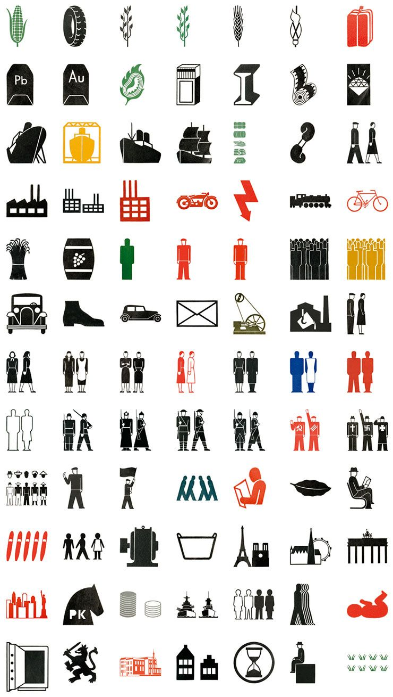
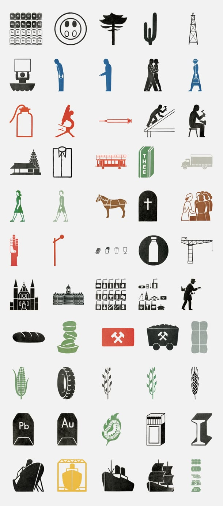
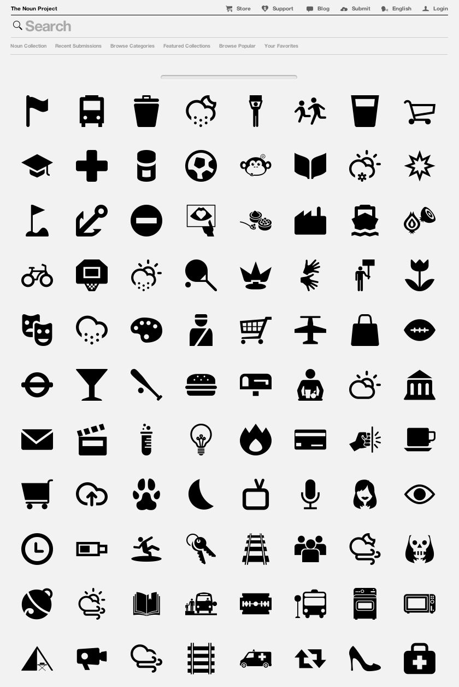
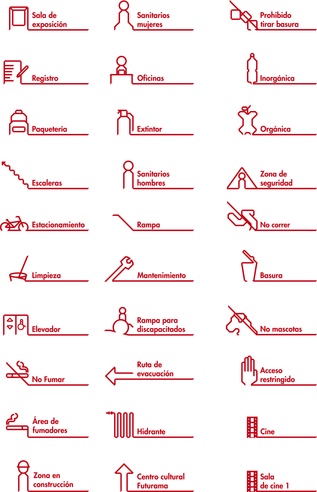
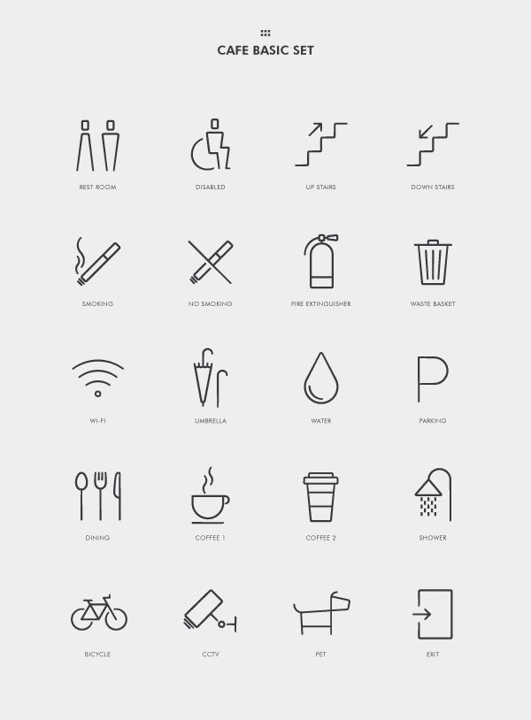

# ISOTYPE 图符与导视案例参考

点击缩略图可查看原图。ISOTYPE 的设计原则、制作流程与统计图例见 [05-ISOTYPE 专题](../../05-ISOTYPE/README.md)。

| 预览 | 案例参考 |
| --- | --- |
|  | [图符图集](01-isotype-pictograms.jpg)。人物、工厂和交通工具的剪影。 |
|  | [图符样张](02-isotype-symbol-sheet.jpg)。职业人物、劳动动作和日常器物。 |
|  | [The Noun Project](03-the-noun-project.jpg)。黑白图标库的网格陈列。 |
|  | [Centro Cultural Futurama](04-futurama-wayfinding.jpg)。红色线描标识与西班牙语导视文字。 |
|  | [Cafe Basic Set](05-cafe-basic-set.jpg)。用细线描绘咖啡馆的设施与服务。 |

[返回类型案例总索引](../README.md)
