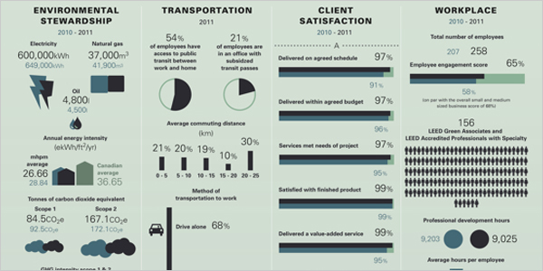

# P022-I01｜环境与职场指标混合图

## 原图与来源

- 案例编号：P022-I01；本库标题为检索描述，不自动视为原作正式名称。
- 来源：用户提供的《第三讲-信息图形类型学_PPT图片提取包.zip》，课件第 22 页、第 1 张图。
- 素材包原路径：`常用信息图形案例库/01-混合型信息图形Mixed Charts/01-示例图/PPT第22页-图片01.png`。
- 原图：600×300 像素，保留提取文件的原始字节；SHA-256：`d93dee89bca0cb02db6efbb7bafab3353afe18db0237d480e4977c81091183b6`。
- 作者、原始发表日期、数据原始出处：未独立核对，原图可见标识不自动等于作者署名。
- 本记录更新：2026-11-20；已核对可见画面结构并完成 A—E 分析，细小数值与原始数据仍以核对状态为准。

## 可直接观察的画面

绿色底面分成环境、交通、客户满意度和职场四列，包含图标、饼形、条带、人物阵列和数值。

## A 基本的数据逻辑

主题分组中的多种指标，单位并不相同；属于编目式模块组织。

## B 统计图形与计算

小型构成图、条形和人物阵列并列；各模块须分别核对分母、单位和年份。

## C 视觉编码

闪电、水滴、车辆和人物指代对象，条长与构成形表达量；背景色统一版面。

未在画面中建立明确数值映射的大小、颜色、纹理与立体效果，不据此反算数据；没有出现的视觉要素不强行补写。

## D 数据／信息架构

四列各有标题、主数据和细项，读者可按主题跳读。

## E 视觉叙事架构

先从列标题建立范围，再读取关键数值并进入细项。

以上为根据编排作的阅读路径分析，不是经过眼动或记忆实验测得的结果。

## 边界、待核实项与方法修订

图像仅 600×300，部分微小图例无法辨认；图标阵列的单位不可自行补写。

本记录的画面描述属于直接观察；数据关系与叙事路径属于分析解释。原始统计表、作者意图和未辨清的微小标签不补造。新证据出现时同步修订此记录、类型方法和相关逻辑文档。

## 关联文档

[本类型说明与案例索引](README.md) · [全部常用类型](../README.md) · [来源与页码对照](../PDF对照与案例索引.md)

相关数据逻辑或判别边界：[编目型信息图形概念定义](../../01-信息图形数据逻辑/03-编目型信息图形概念定义.md)。
