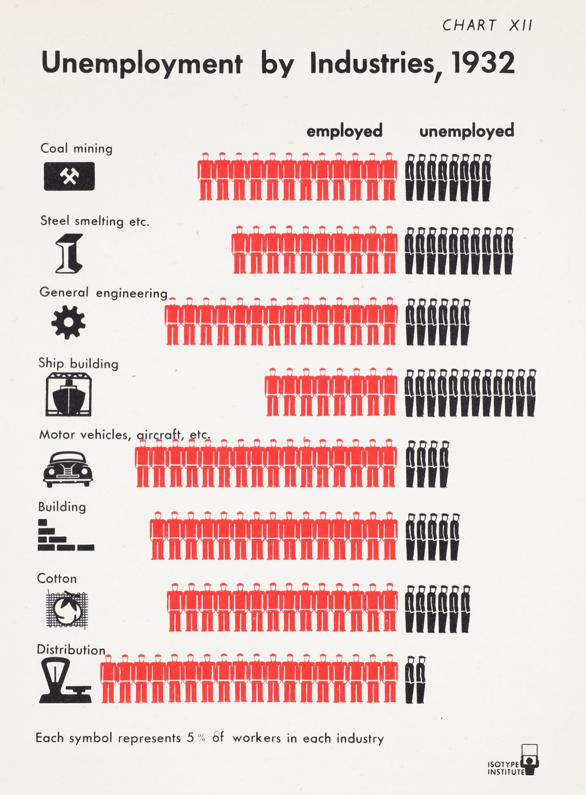

# P059-I01｜1932年分行业就业与失业单位图

## 原图与来源

- 案例编号：P059-I01；本库标题为检索描述，不自动视为原作正式名称。
- 来源：用户提供的《第三讲-信息图形类型学_PPT图片提取包.zip》，课件第 59 页、第 1 张图。
- 素材包原路径：`常用信息图形案例库/补充案例-设计原则/第四章-艺术与交流/01-示例图/PPT第59页-图片01.png`。
- 原图：1320×1788 像素，保留提取文件的原始字节；SHA-256：`33d93b4e6fc8e99689e3da7649934b06a8cff01e4173993ea1360df41cea5c99`。
- 作者、原始发表日期、数据原始出处：未独立核对，原图可见标识不自动等于作者署名。
- 本记录更新：2026-11-20；已核对可见画面结构并完成 A—E 分析，细小数值与原始数据仍以核对状态为准。

## 可直接观察的画面

标题提及1932年与行业失业；行业符号在左，红色人物和黑色人物在右分行重复，底部明确一枚代表各行业工人的5%。

## A 基本的数据逻辑

行业×就业状态的比例表，行业总工人数不是共同的绝对分母。

## B 统计图形与计算

重复符号构成比例比较；一枚5%，20枚对应100%，不代表每行业人数相同。

## C 视觉编码

人物的重复数编码比例，红黑区分状态，矿业、钢铁、造船等图标编码行业。

未在画面中建立明确数值映射的大小、颜色、纹理与立体效果，不据此反算数据；没有出现的视觉要素不强行补写。

## D 数据／信息架构

行业行与状态列形成比较矩阵，底部单位说明是读图必需信息。

## E 视觉叙事架构

先理解一枚5%的读法，再逐行业比较两类状态。

以上为根据编排作的阅读路径分析，不是经过眼动或记忆实验测得的结果。

## 边界、待核实项与方法修订

不能把红黑人物数量直接换成各行业绝对就业人数；原始历史数据仍需独立核对。

本记录的画面描述属于直接观察；数据关系与叙事路径属于分析解释。原始统计表、作者意图和未辨清的微小标签不补造。新证据出现时同步修订此记录、类型方法和相关逻辑文档。

## 关联文档

[本类型说明与案例索引](README.md) · [全部常用类型](../README.md) · [来源与页码对照](../PDF对照与案例索引.md)

相关数据逻辑或判别边界：[编目型信息图形概念定义](../../01-信息图形数据逻辑/03-编目型信息图形概念定义.md)。
