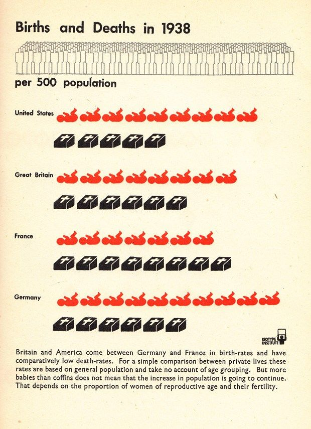

# P061-I02｜1938年出生与死亡单位图

## 原图与来源

- 案例编号：P061-I02；本库标题为检索描述，不自动视为原作正式名称。
- 来源：用户提供的《第三讲-信息图形类型学_PPT图片提取包.zip》，课件第 61 页、第 2 张图。
- 素材包原路径：`常用信息图形案例库/补充案例-设计原则/第四章-艺术与交流/01-示例图/PPT第61页-图片02.jpg`。
- 原图：620×855 像素，保留提取文件的原始字节；SHA-256：`1ba5d24ff718fb1818172e1f086b5ec473bcb0c18a587f5851cd57f37df31cd0`。
- 作者、原始发表日期、数据原始出处：未独立核对，原图可见标识不自动等于作者署名。
- 本记录更新：2026-11-20；已核对可见画面结构并完成 A—E 分析，细小数值与原始数据仍以核对状态为准。

## 可直接观察的画面

标题为1938年出生与死亡，顶部标 per 500 population；多国条目分别排列红色婴儿与黑色棺材符号，底部有解释段落。

## A 基本的数据逻辑

国家×出生／死亡指标的标准化比较。

## B 统计图形与计算

按每500人口的基准展示重复符号；不把符号数当作各国人口总数。

## C 视觉编码

婴儿与棺材表达指标语义，重复数量表达差异，红黑区分两组。

未在画面中建立明确数值映射的大小、颜色、纹理与立体效果，不据此反算数据；没有出现的视觉要素不强行补写。

## D 数据／信息架构

统一人口基准置顶，每国一组，文字补充对指标解释的限制。

## E 视觉叙事架构

由共同基准进入国别比较，底部文字限制对人口增长的简单推断。

以上为根据编排作的阅读路径分析，不是经过眼动或记忆实验测得的结果。

## 边界、待核实项与方法修订

人口年龄结构、育龄人口及统计口径会影响解释；不能仅凭出生多于死亡外推未来趋势。

本记录的画面描述属于直接观察；数据关系与叙事路径属于分析解释。原始统计表、作者意图和未辨清的微小标签不补造。新证据出现时同步修订此记录、类型方法和相关逻辑文档。

## 关联文档

[本类型说明与案例索引](README.md) · [全部常用类型](../README.md) · [来源与页码对照](../PDF对照与案例索引.md)

相关数据逻辑或判别边界：[编目型信息图形概念定义](../../01-信息图形数据逻辑/03-编目型信息图形概念定义.md)。
