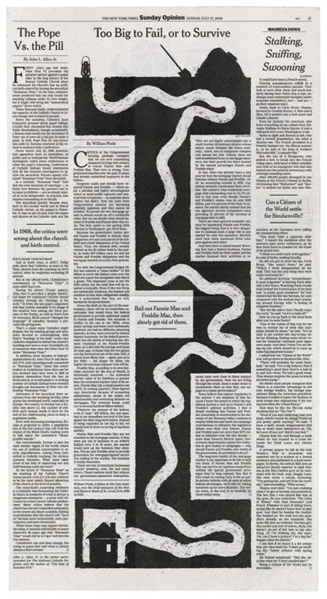

# P023-I01｜报纸专栏与迷宫式视觉说明

## 原图与来源

- 案例编号：P023-I01；本库标题为检索描述，不自动视为原作正式名称。
- 来源：用户提供的《第三讲-信息图形类型学_PPT图片提取包.zip》，课件第 23 页、第 1 张图。
- 素材包原路径：`常用信息图形案例库/02-文字型列表型信息图形Informational-List Infographics/01-示例图/PPT第23页-图片01.jpg`。
- 原图：413×756 像素，保留提取文件的原始字节；SHA-256：`23f41a8558a979dbf23b82d279a1aa3c2e52a8055e86bef650f117ba6bcb557b`。
- 作者、原始发表日期、数据原始出处：未独立核对，原图可见标识不自动等于作者署名。
- 本记录更新：2026-11-20；已核对可见画面结构并完成 A—E 分析，细小数值与原始数据仍以核对状态为准。

## 可直接观察的画面

版面有多列新闻文字，中间是黑底白色曲折通道，上端箭头指向入口，下端邻近房屋图形。

## A 基本的数据逻辑

以文章与栏目为主要信息单元，迷宫是解释性比喻；未见标准编号列表。

## B 统计图形与计算

未见可据以计算的统计轴或量值图例；通道长度不作为数值。

## C 视觉编码

黑白对比突出迷宫，箭头与房屋给出语义锚点，栏线和字重建立新闻层级。

未在画面中建立明确数值映射的大小、颜色、纹理与立体效果，不据此反算数据；没有出现的视觉要素不强行补写。

## D 数据／信息架构

多栏正文围绕中央插图，标题、文章和图像共同组织阅读。

## E 视觉叙事架构

中央迷宫先吸引注意，读者再进入周围文章寻找解释。

以上为根据编排作的阅读路径分析，不是经过眼动或记忆实验测得的结果。

## 边界、待核实项与方法修订

课件列于文字／列表型，但它更接近文字主导的编辑版式；不是所有此类作品都具有列表。

本记录的画面描述属于直接观察；数据关系与叙事路径属于分析解释。原始统计表、作者意图和未辨清的微小标签不补造。新证据出现时同步修订此记录、类型方法和相关逻辑文档。

## 关联文档

[本类型说明与案例索引](README.md) · [全部常用类型](../README.md) · [来源与页码对照](../PDF对照与案例索引.md)

相关数据逻辑或判别边界：[编目型信息图形概念定义](../../01-信息图形数据逻辑/03-编目型信息图形概念定义.md)。
