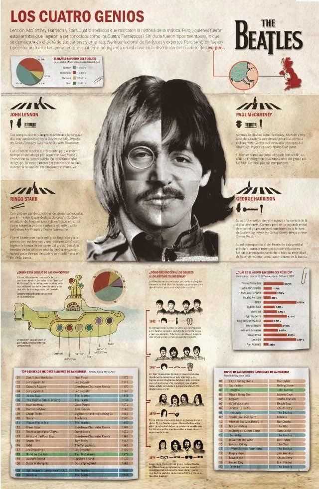

# P023-I02｜披头士人物与音乐信息列表

## 原图与来源

- 案例编号：P023-I02；本库标题为检索描述，不自动视为原作正式名称。
- 来源：用户提供的《第三讲-信息图形类型学_PPT图片提取包.zip》，课件第 23 页、第 2 张图。
- 素材包原路径：`常用信息图形案例库/02-文字型列表型信息图形Informational-List Infographics/01-示例图/PPT第23页-图片02.jpg`。
- 原图：640×982 像素，保留提取文件的原始字节；SHA-256：`d641a5d76d11d3464f5af77f0a7f76c9e90243b4da06f6752b86698b32d4280d`。
- 作者、原始发表日期、数据原始出处：未独立核对，原图可见标识不自动等于作者署名。
- 本记录更新：2026-11-20；已核对可见画面结构并完成 A—E 分析，细小数值与原始数据仍以核对状态为准。

## 可直接观察的画面

顶部可见 Beatles 相关标题，中央为拼合的人像，四周分布人物文字、乐器符号、唱片和列表模块。

## A 基本的数据逻辑

乐队成员、作品和音乐相关属性按主题分类组织。

## B 统计图形与计算

含小型比例与条形组件；因细字较小，数值、比例口径不据缩略图转录。

## C 视觉编码

人像提供识别中心，色彩区分局部模块，乐器和成员符号承载语义。

未在画面中建立明确数值映射的大小、颜色、纹理与立体效果，不据此反算数据；没有出现的视觉要素不强行补写。

## D 数据／信息架构

中心人物建立主题，外围按成员／作品等分区，底部进一步列表。

## E 视觉叙事架构

由熟悉的人物进入，可沿兴趣跳读不同知识模块。

以上为根据编排作的阅读路径分析，不是经过眼动或记忆实验测得的结果。

## 边界、待核实项与方法修订

属于文字解释与混合图形的交叉案例；不要把装饰性的拼接人像当成统计份额。

本记录的画面描述属于直接观察；数据关系与叙事路径属于分析解释。原始统计表、作者意图和未辨清的微小标签不补造。新证据出现时同步修订此记录、类型方法和相关逻辑文档。

## 关联文档

[本类型说明与案例索引](README.md) · [全部常用类型](../README.md) · [来源与页码对照](../PDF对照与案例索引.md)

相关数据逻辑或判别边界：[编目型信息图形概念定义](../../01-信息图形数据逻辑/03-编目型信息图形概念定义.md)。
