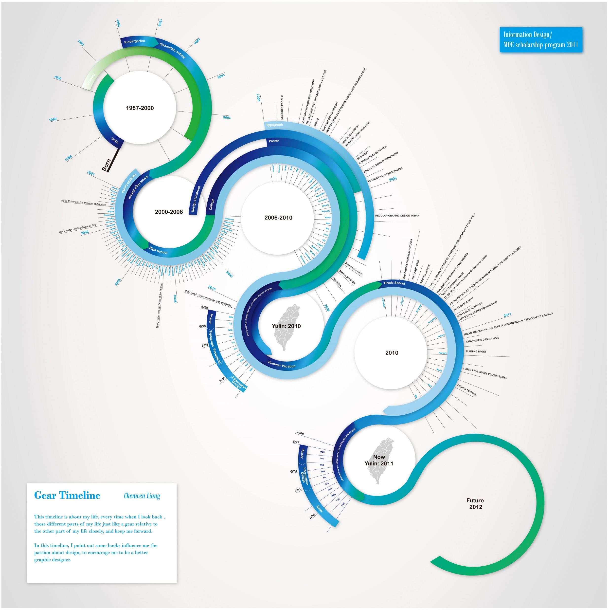

# P003-I01｜齿轮式个人成长时间线

## 原图与来源

- 案例编号：P003-I01；本库标题为检索描述，不自动视为原作正式名称。
- 来源：用户提供的《第三讲-信息图形类型学_PPT图片提取包.zip》，课件第 3 页、第 1 张图。
- 素材包原路径：`01-编年型信息图形Chronological Infographics/01-示例图/PPT第03页-图片01.jpg`。
- 原图：2470×2473 像素，保留提取文件的原始字节；SHA-256：`eaf9d60e6852fd3e3f5e23c33575169493eda21303c1fccf935aabfe7142e83e`。
- 作者、原始发表日期、数据原始出处：未独立核对，原图可见标识不自动等于作者署名。
- 本记录更新：2026-11-20；已核对可见画面结构并完成 A—E 分析，细小数值与原始数据仍以核对状态为准。

## 可直接观察的画面

多个蓝绿圆环沿曲线相接，环内标出不同年份范围，外侧有月份、书名与学习经历的引线；左下有 Gear Timeline 标题。

## A 基本的数据逻辑

人生事件、学习阶段与阅读记录按时间组织；各环的时间跨度不同。

## B 统计图形与计算

环形时间线与阶段弧带；不跨环直接比较弧长或面积来推断时长。

## C 视觉编码

弧带表示阶段或类别，引线连接事件文字；蓝绿层次区分轨道，渐变未见量值图例。

未在画面中建立明确数值映射的大小、颜色、纹理与立体效果，不据此反算数据；没有出现的视觉要素不强行补写。

## D 数据／信息架构

分期圆环提供概要，年月与文字提供细节；书籍记录与生活阶段并置。

## E 视觉叙事架构

从出生和早期阶段进入，沿相接圆环推进到当前及未来。

以上为根据编排作的阅读路径分析，不是经过眼动或记忆实验测得的结果。

## 边界、待核实项与方法修订

不同圆环采用不同时间粒度，必须逐环读刻度；未来部分属于计划，不是已发生事实。

本记录的画面描述属于直接观察；数据关系与叙事路径属于分析解释。原始统计表、作者意图和未辨清的微小标签不补造。新证据出现时同步修订此记录、类型方法和相关逻辑文档。

## 关联文档

[本类型说明与案例索引](README.md) · [全部常用类型](../README.md) · [来源与页码对照](../PDF对照与案例索引.md)

相关数据逻辑或判别边界：[编年型信息图形概念定义](../../01-信息图形数据逻辑/01-编年型信息图形概念定义.md)。
