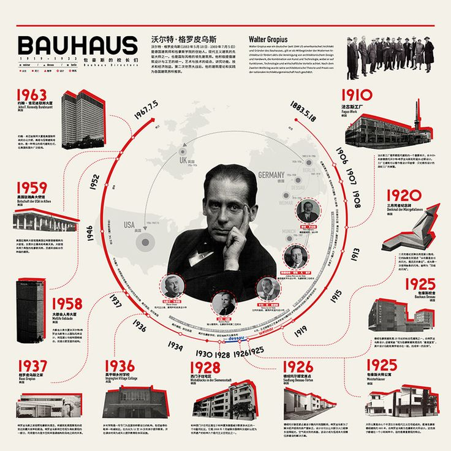

# P024-I01｜包豪斯建筑与人物环形时间线

## 原图与来源

- 案例编号：P024-I01；本库标题为检索描述，不自动视为原作正式名称。
- 来源：用户提供的《第三讲-信息图形类型学_PPT图片提取包.zip》，课件第 24 页、第 1 张图。
- 素材包原路径：`常用信息图形案例库/03-时间轴型信息图形Timeline Infographics/01-示例图/PPT第24页-图片01.jpg`。
- 原图：736×736 像素，保留提取文件的原始字节；SHA-256：`c7ca57ee7f667c96fdde7367e302ce91ffeeaba6042932313b5bde08844b8626`。
- 作者、原始发表日期、数据原始出处：未独立核对，原图可见标识不自动等于作者署名。
- 本记录更新：2026-11-20；已核对可见画面结构并完成 A—E 分析，细小数值与原始数据仍以核对状态为准。

## 可直接观察的画面

中央人物与淡色地图被环形年代线包围，外围以红色年份、建筑图和说明文字分组。

## A 基本的数据逻辑

人物经历、建筑事件与年份建立对应，辅以地点信息。

## B 统计图形与计算

环形事件时间线；外围建筑图大小不等于时间长度或建筑规模。

## C 视觉编码

红色年代与轮廓形成强调，线连接节点，建筑和肖像提供事件识别。

未在画面中建立明确数值映射的大小、颜色、纹理与立体效果，不据此反算数据；没有出现的视觉要素不强行补写。

## D 数据／信息架构

中心主题、内圈关联、外围年代与建筑注释形成层次。

## E 视觉叙事架构

先识别人和主题，再沿年代逐项理解建筑与经历。

以上为根据编排作的阅读路径分析，不是经过眼动或记忆实验测得的结果。

## 边界、待核实项与方法修订

环周间隔是否严格按时间比例仍需逐段核对；不能仅凭环形外观判定为周期循环。

本记录的画面描述属于直接观察；数据关系与叙事路径属于分析解释。原始统计表、作者意图和未辨清的微小标签不补造。新证据出现时同步修订此记录、类型方法和相关逻辑文档。

## 关联文档

[本类型说明与案例索引](README.md) · [全部常用类型](../README.md) · [来源与页码对照](../PDF对照与案例索引.md)

相关数据逻辑或判别边界：[编年型信息图形概念定义](../../01-信息图形数据逻辑/01-编年型信息图形概念定义.md) · [地理图形信息图形概念定义](../../01-信息图形数据逻辑/05-地理图形信息图形概念定义.md)。
