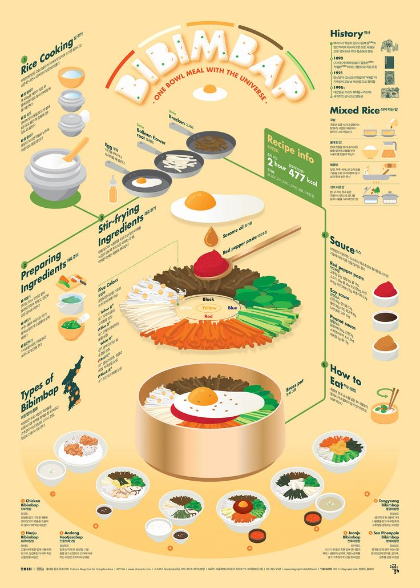

# P025-I01｜拌饭食材与制作示意

## 原图与来源

- 案例编号：P025-I01；本库标题为检索描述，不自动视为原作正式名称。
- 来源：用户提供的《第三讲-信息图形类型学_PPT图片提取包.zip》，课件第 25 页、第 1 张图。
- 素材包原路径：`常用信息图形案例库/04-示意图型信息图形How-to Infographics/01-示例图/PPT第25页-图片01.jpg`。
- 原图：736×1030 像素，保留提取文件的原始字节；SHA-256：`c5d3ad78ee72e6a7196ccb75d3f2299a32e7eac14d0815da0834b3ff09a9d851`。
- 作者、原始发表日期、数据原始出处：未独立核对，原图可见标识不自动等于作者署名。
- 本记录更新：2026-11-20；已核对可见画面结构并完成 A—E 分析，细小数值与原始数据仍以核对状态为准。

## 可直接观察的画面

黄色背景上，食材、鸡蛋、锅碗等沿纵向分层展开，侧边补充配料、步骤、类型和食用方法。

## A 基本的数据逻辑

食材集合、部件层次与制作动作并存。

## B 统计图形与计算

爆炸分解式食谱和步骤图；图中食材插画大小不是已标定的重量。

## C 视觉编码

食材物象识别原料，连线定位说明，层叠面表现组合，色彩区分食物。

未在画面中建立明确数值映射的大小、颜色、纹理与立体效果，不据此反算数据；没有出现的视觉要素不强行补写。

## D 数据／信息架构

中央说明组合关系，两侧交代准备、烹饪和使用细节。

## E 视觉叙事架构

从原料准备到组合成餐，再延伸到吃法。

以上为根据编排作的阅读路径分析，不是经过眼动或记忆实验测得的结果。

## 边界、待核实项与方法修订

应区分空间分层与实际操作次序；精确配比、时长和食品安全条件不从插画推断。

本记录的画面描述属于直接观察；数据关系与叙事路径属于分析解释。原始统计表、作者意图和未辨清的微小标签不补造。新证据出现时同步修订此记录、类型方法和相关逻辑文档。

## 关联文档

[本类型说明与案例索引](README.md) · [全部常用类型](../README.md) · [来源与页码对照](../PDF对照与案例索引.md)

相关数据逻辑或判别边界：[编目型信息图形概念定义](../../01-信息图形数据逻辑/03-编目型信息图形概念定义.md) · [层级型信息图形概念定义](../../01-信息图形数据逻辑/02-层级型信息图形概念定义.md)。
