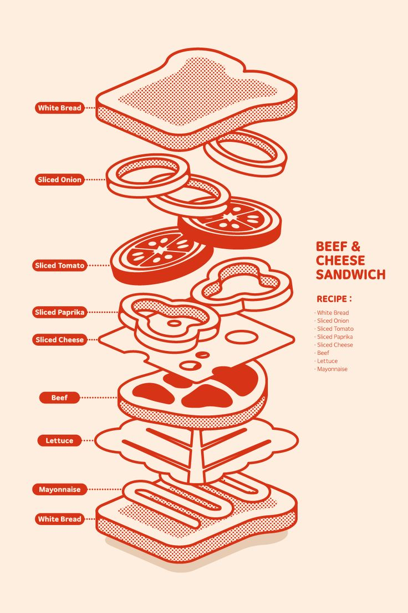

# P025-I02｜牛肉芝士三明治分层示意

## 原图与来源

- 案例编号：P025-I02；本库标题为检索描述，不自动视为原作正式名称。
- 来源：用户提供的《第三讲-信息图形类型学_PPT图片提取包.zip》，课件第 25 页、第 2 张图。
- 素材包原路径：`常用信息图形案例库/04-示意图型信息图形How-to Infographics/01-示例图/PPT第25页-图片02.jpg`。
- 原图：736×1104 像素，保留提取文件的原始字节；SHA-256：`802cb1b8eb1da5282e22b323018a04b9d34478dd908be377ce32751d4d029326`。
- 作者、原始发表日期、数据原始出处：未独立核对，原图可见标识不自动等于作者署名。
- 本记录更新：2026-11-20；已核对可见画面结构并完成 A—E 分析，细小数值与原始数据仍以核对状态为准。

## 可直接观察的画面

红色线描的面包、洋葱、番茄、芝士、牛肉与蔬菜逐层悬浮，侧边标签连到各层，右侧列配料。

## A 基本的数据逻辑

成品与各食材组成关系，另有配料目录。

## B 统计图形与计算

采用爆炸图说明组成；未见统计量尺，层间距不表达用量或时间。

## C 视觉编码

引线连接名称与食材，统一红色保持风格，面与纹理区分原料。

未在画面中建立明确数值映射的大小、颜色、纹理与立体效果，不据此反算数据；没有出现的视觉要素不强行补写。

## D 数据／信息架构

中央分解图、侧边部件标签与右侧清单互相补充。

## E 视觉叙事架构

从成品概念进入各层，读者可以按组合关系理解制作。

以上为根据编排作的阅读路径分析，不是经过眼动或记忆实验测得的结果。

## 边界、待核实项与方法修订

不能因层从上到下排列就断定必须按同方向操作；配料数量须看原食谱。

本记录的画面描述属于直接观察；数据关系与叙事路径属于分析解释。原始统计表、作者意图和未辨清的微小标签不补造。新证据出现时同步修订此记录、类型方法和相关逻辑文档。

## 关联文档

[本类型说明与案例索引](README.md) · [全部常用类型](../README.md) · [来源与页码对照](../PDF对照与案例索引.md)

相关数据逻辑或判别边界：[层级型信息图形概念定义](../../01-信息图形数据逻辑/02-层级型信息图形概念定义.md) · [编目型信息图形概念定义](../../01-信息图形数据逻辑/03-编目型信息图形概念定义.md)。
