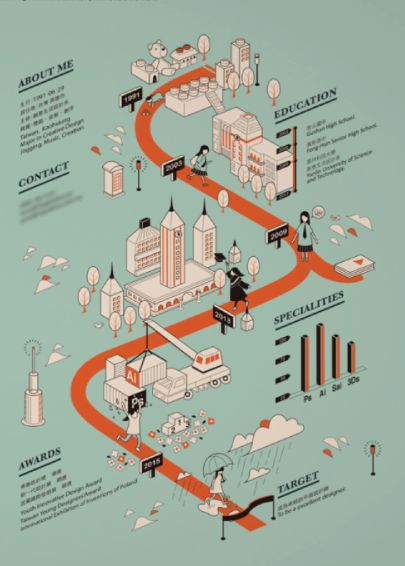

# P026-I01｜道路式个人经历与能力流程

## 原图与来源

- 案例编号：P026-I01；本库标题为检索描述，不自动视为原作正式名称。
- 来源：用户提供的《第三讲-信息图形类型学_PPT图片提取包.zip》，课件第 26 页、第 1 张图。
- 素材包原路径：`常用信息图形案例库/05-流程图型信息图形Process Infographics/01-示例图/PPT第26页-图片01.jpg`。
- 原图：405×566 像素，保留提取文件的原始字节；SHA-256：`d02a8a2bd2d63ef678bdf5afb18bcfeddca97eabc2134a339756f0f8978297fa`。
- 作者、原始发表日期、数据原始出处：未独立核对，原图可见标识不自动等于作者署名。
- 本记录更新：2026-11-20；已核对可见画面结构并完成 A—E 分析，细小数值与原始数据仍以核对状态为准。

## 可直接观察的画面

一条橙红色道路穿过建筑和年份牌，附近有教育、专业、奖项、目标等信息与技能条形。

## A 基本的数据逻辑

个人经历与能力栏目混合，部分节点有年份。

## B 统计图形与计算

旅程路线与技能条形并置；技能条未见客观测量基准。

## C 视觉编码

道路连接阶段，建筑隐喻学习／工作环境，年份牌定位节点，条长表示自述水平。

未在画面中建立明确数值映射的大小、颜色、纹理与立体效果，不据此反算数据；没有出现的视觉要素不强行补写。

## D 数据／信息架构

经历路径为主线，周围栏目提供联系、教育和技能信息。

## E 视觉叙事架构

沿道路从较早经历走向目标，兼具视觉简历功能。

以上为根据编排作的阅读路径分析，不是经过眼动或记忆实验测得的结果。

## 边界、待核实项与方法修订

课件列流程型，但不是严格业务流程；经历先后、操作依赖和主观技能评级应分开。

本记录的画面描述属于直接观察；数据关系与叙事路径属于分析解释。原始统计表、作者意图和未辨清的微小标签不补造。新证据出现时同步修订此记录、类型方法和相关逻辑文档。

## 关联文档

[本类型说明与案例索引](README.md) · [全部常用类型](../README.md) · [来源与页码对照](../PDF对照与案例索引.md)

相关数据逻辑或判别边界：[编年型信息图形概念定义](../../01-信息图形数据逻辑/01-编年型信息图形概念定义.md) · [编目型信息图形概念定义](../../01-信息图形数据逻辑/03-编目型信息图形概念定义.md)。
