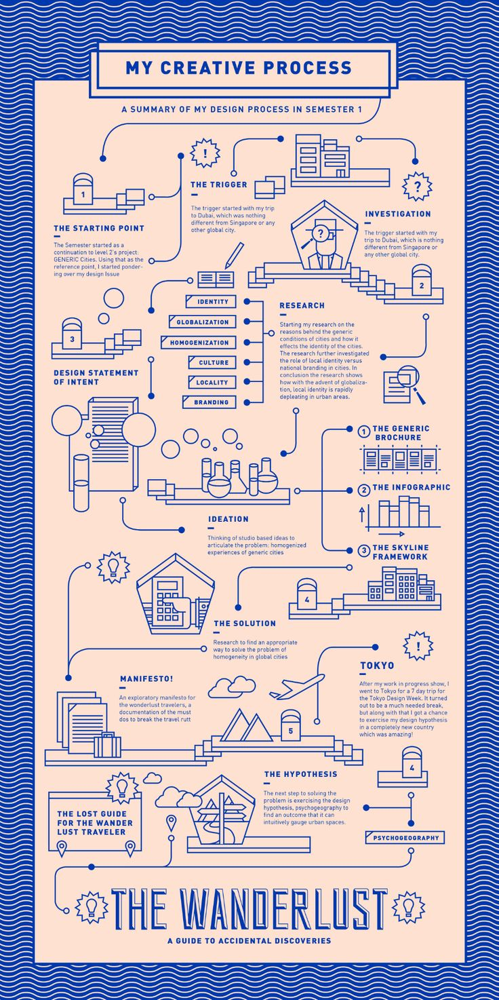

# P026-I02｜创意设计过程流程图

## 原图与来源

- 案例编号：P026-I02；本库标题为检索描述，不自动视为原作正式名称。
- 来源：用户提供的《第三讲-信息图形类型学_PPT图片提取包.zip》，课件第 26 页、第 2 张图。
- 素材包原路径：`常用信息图形案例库/05-流程图型信息图形Process Infographics/01-示例图/PPT第26页-图片02.jpg`。
- 原图：736×1474 像素，保留提取文件的原始字节；SHA-256：`cf2fe753fd3a000180c7f6d087a6f6decdb4704223c55d0642461dfec9211bf6`。
- 作者、原始发表日期、数据原始出处：未独立核对，原图可见标识不自动等于作者署名。
- 本记录更新：2026-11-20；已核对可见画面结构并完成 A—E 分析，细小数值与原始数据仍以核对状态为准。

## 可直接观察的画面

蓝色线条在浅色长版面中连接门、灯泡、问题、研究和方案等图形模块，顶部为 My Creative Process。

## A 基本的数据逻辑

设计任务的阶段、分支和反馈关系。

## B 统计图形与计算

节点连接式过程图；线段长度未标为时间或工作量。

## C 视觉编码

箭头和连接线编码推进与反馈，图标提示阶段任务，标题框建立层级。

未在画面中建立明确数值映射的大小、颜色、纹理与立体效果，不据此反算数据；没有出现的视觉要素不强行补写。

## D 数据／信息架构

起点、调查与思考、方案及结果模块沿连线展开。

## E 视觉叙事架构

依连接路径阅读工作推进，并辨认可能的分支或回返。

以上为根据编排作的阅读路径分析，不是经过眼动或记忆实验测得的结果。

## 边界、待核实项与方法修订

不能只依上下位置认定唯一顺序；须沿实际箭头核对回路和阶段关系。

本记录的画面描述属于直接观察；数据关系与叙事路径属于分析解释。原始统计表、作者意图和未辨清的微小标签不补造。新证据出现时同步修订此记录、类型方法和相关逻辑文档。

## 关联文档

[本类型说明与案例索引](README.md) · [全部常用类型](../README.md) · [来源与页码对照](../PDF对照与案例索引.md)

相关数据逻辑或判别边界：[编目型信息图形概念定义](../../01-信息图形数据逻辑/03-编目型信息图形概念定义.md)。
