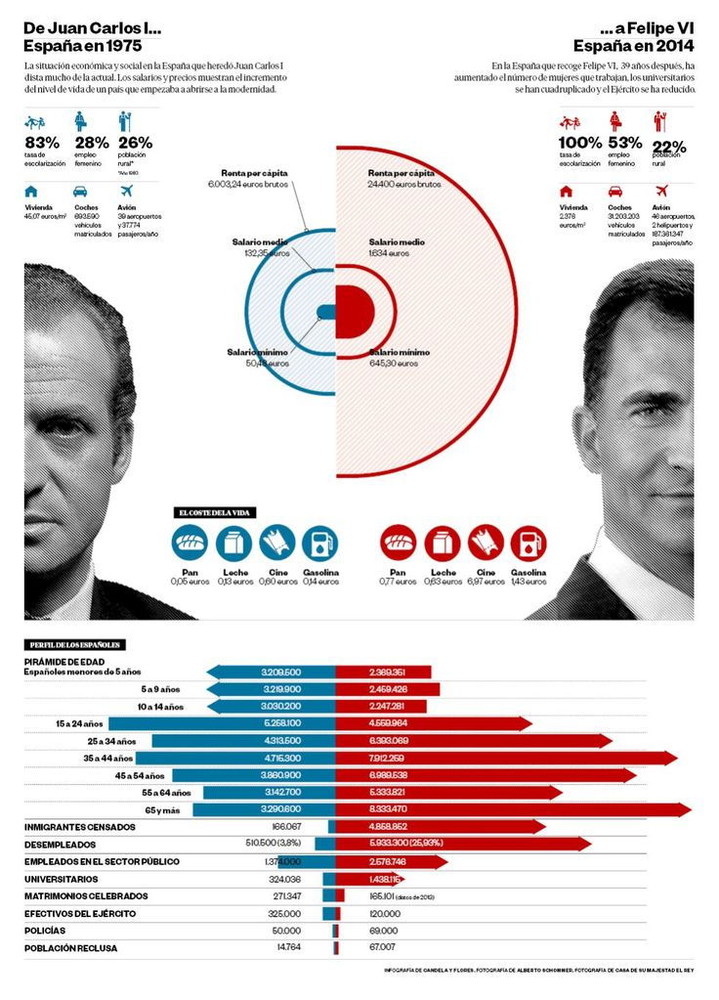

# P027-I01｜西班牙两个时期指标对照

## 原图与来源

- 案例编号：P027-I01；本库标题为检索描述，不自动视为原作正式名称。
- 来源：用户提供的《第三讲-信息图形类型学_PPT图片提取包.zip》，课件第 27 页、第 1 张图。
- 素材包原路径：`常用信息图形案例库/06-比较型信息图形Comparison Infographics/01-示例图/PPT第27页-图片01.jpg`。
- 原图：736×1023 像素，保留提取文件的原始字节；SHA-256：`fedbb3794f9e71bc55b2f95ed1ba6a8c59e7e41cab1bd2fcef34cab87953b13d`。
- 作者、原始发表日期、数据原始出处：未独立核对，原图可见标识不自动等于作者署名。
- 本记录更新：2026-11-20；已核对可见画面结构并完成 A—E 分析，细小数值与原始数据仍以核对状态为准。

## 可直接观察的画面

左右分别使用蓝色与红色，标题出现1975与2014，中央人物肖像与弧线指标下方是成对横条。

## A 基本的数据逻辑

同一地区两个历史时期、同一组社会经济指标的对照。

## B 统计图形与计算

镜像／成对条形、比例与数值注释组合；指标单位各异，不横跨指标比较条长。

## C 视觉编码

蓝红分别标识时期，左右对称强化比较，图标提示指标类别。

未在画面中建立明确数值映射的大小、颜色、纹理与立体效果，不据此反算数据；没有出现的视觉要素不强行补写。

## D 数据／信息架构

时期标题在上，共享指标逐项对齐，底部展开人口与职业等条目。

## E 视觉叙事架构

先建立过去与现在的对比框架，再按指标寻找差异。

以上为根据编排作的阅读路径分析，不是经过眼动或记忆实验测得的结果。

## 边界、待核实项与方法修订

年份是比较条件，不意味着已经展示两时点之间的连续趋势；币值和统计口径需核对。

本记录的画面描述属于直接观察；数据关系与叙事路径属于分析解释。原始统计表、作者意图和未辨清的微小标签不补造。新证据出现时同步修订此记录、类型方法和相关逻辑文档。

## 关联文档

[本类型说明与案例索引](README.md) · [全部常用类型](../README.md) · [来源与页码对照](../PDF对照与案例索引.md)

相关数据逻辑或判别边界：[编年型信息图形概念定义](../../01-信息图形数据逻辑/01-编年型信息图形概念定义.md) · [编目型信息图形概念定义](../../01-信息图形数据逻辑/03-编目型信息图形概念定义.md)。
