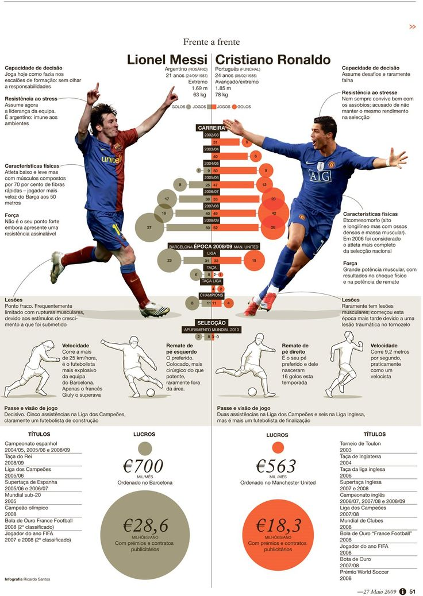

# P027-I02｜梅西与C罗的体育数据对照

## 原图与来源

- 案例编号：P027-I02；本库标题为检索描述，不自动视为原作正式名称。
- 来源：用户提供的《第三讲-信息图形类型学_PPT图片提取包.zip》，课件第 27 页、第 2 张图。
- 素材包原路径：`常用信息图形案例库/06-比较型信息图形Comparison Infographics/01-示例图/PPT第27页-图片02.jpg`。
- 原图：736×1038 像素，保留提取文件的原始字节；SHA-256：`2a71a16ef0d01836da7049603e3c29e95186ceb4d4451dac2033c8f86e922bb8`。
- 作者、原始发表日期、数据原始出处：未独立核对，原图可见标识不自动等于作者署名。
- 本记录更新：2026-11-20；已核对可见画面结构并完成 A—E 分析，细小数值与原始数据仍以核对状态为准。

## 可直接观察的画面

两位运动员照片分居左右，中间按指标成对排列圆形与条形，底部另有金额圆形和文字。

## A 基本的数据逻辑

两名对象共享的体育表现、身体与收入等属性比较。

## B 统计图形与计算

配对条形／圆形与数值；金额、次数和身体指标不共用一个量纲。

## C 视觉编码

左右位置和颜色固定对应对象，照片提供身份，圆和条承载指标。

未在画面中建立明确数值映射的大小、颜色、纹理与立体效果，不据此反算数据；没有出现的视觉要素不强行补写。

## D 数据／信息架构

顶部身份与关键资料，中部逐项对比，底部补充商业与成绩信息。

## E 视觉叙事架构

读者先识别对象，再沿对齐指标比较差异。

以上为根据编排作的阅读路径分析，不是经过眼动或记忆实验测得的结果。

## 边界、待核实项与方法修订

圆的面积与直径映射需另核对；历史数据仅作为原图当时表述，不能当作现状。

本记录的画面描述属于直接观察；数据关系与叙事路径属于分析解释。原始统计表、作者意图和未辨清的微小标签不补造。新证据出现时同步修订此记录、类型方法和相关逻辑文档。

## 关联文档

[本类型说明与案例索引](README.md) · [全部常用类型](../README.md) · [来源与页码对照](../PDF对照与案例索引.md)

相关数据逻辑或判别边界：[编目型信息图形概念定义](../../01-信息图形数据逻辑/03-编目型信息图形概念定义.md)。
