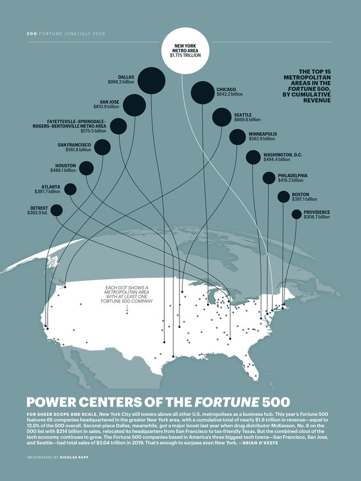

# C001｜Fortune 500 都市区营收：外置圆符号与地图关联

## 先判01，再判02

| 判断层次 | 归属 | 判断依据 |
| --- | --- | --- |
| 01 五种数据逻辑中的主类 | **05-地理图形信息图形** | 观察对象是具有真实位置的都市区。地图点与都市区营收通过同一地点身份对应，共同回答“企业经济中心在哪里、规模多大” |
| 01 辅助关系 | 营收数值排序、都市区条目检索 | 排名服务于空间比较；本图没有展示企业组织的父子树 |
| 02 主要归档标签 | **07-地标型信息图形（Location Infographics）** | 地理位置承担实质信息，地图不是可随意替换的背景 |
| 02 交叉标签 | **01-混合型信息图形、06-比较型信息图形** | 地图、变尺度圆、引导线、精确标签和说明文字共同组织同一主题，城市之间共享营收指标 |
| 可检索形式标签 | 外置圆符号、地点属性比较、曲线引导线、规模排序、主角反白、低饱和配色 | 这些是案例检索词，不新增类型目录 |
| 不采用的主标签 | 时间轴、树状层级、流向图、三维数据图 | 年份文字不是时间轴；引导线不是父子边或资金流；底图透视不表示数据体积 |

**归档原则**：一图一处保存，混合型与比较型只做交叉链接。这里的“外置圆符号与地图关联”是对可见构造的分析描述，不声称是原作者给出的图种名称。

### 五类逐项排除与确定

| 01类别 | 本图是否以它为主 | 具体理由 |
| --- | --- | --- |
| 编年型 | 否 | 刊期、榜单年份和正文中的销售额年份用于限定时期，没有连续时间坐标或状态变化序列 |
| 层级型 | 否；存在辅助等级排序 | 本库允许“等级”口径，但本图主任务是空间定位与量值比较。圆的上下排列不构成父子从属，连线也不是层级边 |
| 编目型 | 否；存在条目浏览 | 都市区名称构成可查找的对象集合，但没有把主题分类或目录检索作为主要叙事 |
| 字母表型 | 否 | 没有按字母顺序组织地名 |
| 地理图形 | 是 | 图例把小点定义为都市区；大圆与具体地理锚点逐项关联，地点归属是指标意义的一部分 |

## 原图、来源与核验状态

- 稳定编号：C001。独立用户图片，不采用课件页序P编号。
- 正式原作标题：POWER CENTERS OF THE FORTUNE 500。
- 可见出版信息：FORTUNE，JUNE/JULY 2020，印刷页码200。**200是杂志页码，不是本仓库课件实际页序。**
- 原图可见署名：信息图 NICOLAS RAPP；正文 BRIAN O’KEEFE。
- 来源：用户在本次会话提供的图片；原始文件名 112ce92fe058c111d13e90e943a54467.jpg。
- 图像版本：736 × 981像素，77,190字节。C001.jpg保留所提供JPEG的原始字节。
- 原图SHA-256：9d4c5eb8428fc6c09798de69236f86068cf5fb4b3fc132f11fefaef64b00faaf。
- 数据附表：[C001.xlsx](C001.xlsx)。保留本次会话已完成的Excel，含都市区营收、统计分析、正文与来源、视觉与口径四表；数值、单位与币种分列。
- 证据状态：来源已登记、画面已核对、A—E已分析、原则已同步；**图上标签已转录，企业原始财报、都市区正式边界、地图投影和原作者工程文件未独立复核。**
- 更新日期：2026-11-20。以下制作流程是基于成图重建的可执行方案，不能当作原作者实际使用软件和操作记录。

## 可直接观察的画面与特性

| 区域或要素 | 直接观察 | 信息作用的分析 |
| --- | --- | --- |
| 整体画幅 | 竖版，接近3∶4 | 上方留给符号比较，中下部建立地理情境，底部文字解释 |
| 上方符号 | 纽约在顶端，白圆最大；其余都市区为深色圆，向两侧逐步展开 | 首位城市先被强调，其余城市形成连续规模对照 |
| 右上副标题 | 指出前十五个都市区，按累计营收比较 | 先限定对象与指标，避免把大圆理解为人口或总部数量 |
| 城市标签 | 每个大圆附近给出英文地名与美元营收 | 精确值由文字读取，不要求读者估算圆大小 |
| 中下方地图 | 美国本土为白色，周边陆地较暗；使用倾斜的空间视角 | 美国与周边背景分离，提供方位与空间分布 |
| 地图小点 | 图例明确每个点表示至少有一家上榜企业的都市区 | 表示位置与存在，不是一点一家企业 |
| 细曲线 | 从营收圆接到相应地图位置，没有流量图例与方向箭头 | 保持展示符号与真实地点的身份对应 |
| 底部标题与正文 | 标题在底部；正文讨论纽约、达拉斯迁址案例与科技三城合计 | 把规模分布提升为商业中心的解释性故事 |
| 排版 | 大标题粗重，城市名紧凑，精确值字号更小 | 用字号、字重和留白区分主张、对象与证据 |

### 可复用的风格参数

下列颜色为所提供JPEG的像素样本，受压缩影响，只作重制参考，不是原刊品牌色规范。

| 项目 | 参考特征或样本 | 复用条件 |
| --- | --- | --- |
| 主背景 | 灰蓝色，约 #799CA2 | 承托白色地图与深色数据符号 |
| 数据深色 | 近黑蓝，约 #071923 | 城市圆、文字和多数引导线保持一致 |
| 主体白色 | #FFFFFF | 同时用于美国轮廓、纽约强调圆和底部文字；须靠位置与标签区分语义 |
| 周边陆地 | 约 #8FABAF | 对比度低于核心数据层 |
| 字体类别 | 紧凑无衬线与粗重标题 | 原字体名称未知，不据外观补造字体授权或型号 |
| 版式节奏 | 大圆到小圆、全图到个例、图形到解释文字 | 保持重要性与阅读层次，避免机械复制每个像素位置 |
| 透视效果 | 底图倾斜并有空间层次 | 只承担地理情境；不据透视面积计算地域指标 |

## A 基本的数据逻辑

### 数据粒度与关系

主记录为“一个都市区 × 一个榜单版本 × 一个营收指标”。指标是**总部位于该都市区的Fortune 500美国上榜企业营收之和**。它不等于都市区GDP，也不表示企业的销售和生产全部发生在该都市区。

若从企业明细重建：企业表通过同版总部归属表连接都市区，再按都市区聚合。若只依据此图提取：只能建立十五个已标注都市区的指标表，不能伪造其余地图点的名称、精确坐标和企业明细。

| 表 | 一个记录代表什么 | 关键字段 | 与展示的关系 |
| --- | --- | --- | --- |
| 企业明细表（完整重建所需，原图未提供） | 一家企业的同版营收 | company_id、list_year、revenue、currency、fiscal_period、source | 为聚合提供依据，企业需去重 |
| 总部归属表（完整重建所需） | 企业在指定榜单版次归属的都市区 | company_id、list_year、metro_id、assignment_basis | 迁址前后归属规则要统一 |
| 都市区地理表 | 一个空间单元 | metro_id、display_name、anchor_lon、anchor_lat、crs、boundary_version、anchor_basis | 给地图小点提供位置 |
| 都市区指标表 | 一个都市区的该版营收 | metro_id、list_year、raw_value、raw_scale、currency、revenue_billion_usd、source | 支持排序、文字与圆大小 |
| 版面布局表 | 一个营收圆的展示状态 | metro_id、symbol_x、symbol_y、radius、label_side、priority | 不改写地理表的原始坐标 |
| 叙事注释表 | 一个可追溯陈述 | note_id、subject_id、claim、value、unit、period、evidence_status | 纽约、达拉斯与三城组合分别绑定证据 |

**关键分离**：地理锚点回答“在哪里”，展示坐标回答“放在哪里便于阅读”。二者共享metro_id，但不能相互覆盖。画面向上或向右移动的圆，不表示企业在地理上移动。

### 时期和归属边界

原图刊期为2020年，正文“this year”对应榜单版次可推定为2020年。正文明确科技三城合计销售额属于2019年；各企业具体财年起止未逐项给出，不能一律改成“2020自然年营收”。正文“last year”的迁址年份可据刊期推定为2019年，须保留推定标记。

## B 统计图形、原始标签与计算

### 实际采用的构造

主构造为**位置点图 + 外置变尺度圆 + 曲线引导线 + 直接数值标注**。它包含排名比较，但圆的展示横纵位置不是两个统计变量，因此不按普通气泡散点图读取。没有分级设色量尺，没有流量宽度量尺，也没有时间轴。

### 十五个都市区的营收转录

以下排名根据图上数值降序推导；原图并未给每个城市打印名次。统一后的营收单位为十亿美元，币种USD。1 trillion = 1,000 billion；1 billion USD = 10亿美元。

| 推导排名 | 都市区标签 | 原始数值 | 原始量级 | 统一营收（十亿美元） |
| --- | --- | --- | --- | --- |
| 1 | New York Metro Area | 1.775 | trillion | 1775.0 |
| 2 | Dallas | 996.2 | billion | 996.2 |
| 3 | Chicago | 842.2 | billion | 842.2 |
| 4 | San Jose | 810.9 | billion | 810.9 |
| 5 | Seattle | 669.6 | billion | 669.6 |
| 6 | Fayetteville–Springdale–Rogers–Bentonville Metro Area | 575.5 | billion | 575.5 |
| 7 | Minneapolis | 562.9 | billion | 562.9 |
| 8 | San Francisco | 561.8 | billion | 561.8 |
| 9 | Washington, D.C. | 494.4 | billion | 494.4 |
| 10 | Houston | 489.1 | billion | 489.1 |
| 11 | Philadelphia | 418.2 | billion | 418.2 |
| 12 | Atlanta | 397.7 | billion | 397.7 |
| 13 | Boston | 397.1 | billion | 397.1 |
| 14 | Detroit | 393.9 | billion | 393.9 |
| 15 | Providence | 308.7 | billion | 308.7 |

### 原图事实与分析计算分开

| 指标 | 数值 | 单位 | 性质与分母 |
| --- | --- | --- | --- |
| 前十五个都市区营收合计 | 9693.2 | 十亿美元 | 标签相加，只覆盖前十五个都市区 |
| 纽约占前十五营收 | 18.31 | % | 分母为上述前十五合计 |
| 前五个都市区占前十五营收 | 52.55 | % | 同一分母 |
| 纽约总部企业数 | 65 | 家 | 正文明确提供 |
| 纽约企业数量占全部榜单企业 | 13.00 | % | 65 ÷ 500，计算值 |
| 纽约占榜单整体营收 | 12.5 | % | 按正文上下文解释的营收占比，与企业数量占比不同 |
| 麦克森的榜单排名 | 8 | 名 | 正文值 |
| 麦克森销售额 | 214 | 十亿美元 | 正文值 |
| 旧金山、圣何塞与西雅图合计 | 2042.3 | 十亿美元 | 三个图示标签相加 |
| 正文三城合计 | 2.04 | 万亿美元 | 舍入表达，对应2019年销售额 |
| 三城合计超过纽约 | 267.3 | 十亿美元 | 标签相减；约高15.06% |

正文纽约近似值为“nearly 1.8 trillion”，主图标签为1.775 trillion；应保留两个精度，不把它们当作矛盾。科技三城包括西雅图，不能写成仅旧金山湾区的合计。麦克森迁址影响总部归属，原图未给达拉斯上年营收，不能据214这一销售额直接推导达拉斯增长率。

### 圆大小的量尺问题

- **直接观察**：圆随营收增加而增大，纽约明显最大。
- **视觉判断**：外观更接近直径随营收增长；原图没有给出尺寸图例，尚不能确认作者精确的函数、像素舍入与最小尺寸规则。
- **可确认边界**：不把原图说成“圆面积严格与营收成正比”，不由圆面积反算原始数据。
- **重制建议**：若约定面积编码营收v，令 A = k × v，半径 r = √(k × v ÷ π)；以最大圆半径r_max标定时，r_i = r_max × √(v_i ÷ v_max)。图例给出面积尺度，并保留精确标签。
- 若刻意复现原图外观而采用直径近似线性映射，应公开说明量尺。直径翻倍会使面积变成四倍，不能把两者混为同一比例。
- 如为可点击性设置最小尺寸，须说明其非严格比例，或把最小点击区与可见数据圆分离。

## C 具体视觉编码

| 元素 | 画面形式 | 编码或功能 | 可迁移做法 | 防止误读 |
| --- | --- | --- | --- | --- |
| 点 | 地图上较小的深色点 | 都市区位置及上榜企业总部的存在 | 使用稳定地理键与清晰锚点 | 一点不是一家企业，也没有说明一家或多家之间的数量差 |
| 点／面状符号 | 上方不同大小的圆 | 都市区累计营收的大小对比 | 圆大小先标定，再布局 | 原图精确量尺未知 |
| 线 | 细曲线、纽约的浅色引导线 | 同一都市区的展示圆与地图锚点对应 | 从圆边界连到地理锚点，减少穿字与不必要交叉 | 不代表物流、资金流、时间或父子关系 |
| 面 | 白色美国轮廓 | 核心地理范围 | 用区域对比建立主体 | 白色没有编码区域营收 |
| 面 | 低对比周边陆地 | 方位背景与空间情境 | 降低背景对数据层的干扰 | 周边陆地不是额外国家统计 |
| 色彩 | 纽约反白，其他圆深色 | 主角与其他对象的强调关系 | 重点色只承担稳定语义 | 颜色没有划分行业与营收增长 |
| 明度 | 数据层与底图的对比 | 前景／背景层次 | 明度差优先服务辨识 | 不能当作数值色标读取 |
| 文字 | 城市名与营收直接标注 | 对象身份、精确量值 | 名称、数值、单位在数据层拆分，显示层统一格式 | 直接标签承担精读，圆承担概览 |
| 字号与字重 | 底部粗标题、较小正文 | 信息重要性和解释层次 | 主张、对象、证据分层 | 字重不代表统计权重 |
| 展示位置 | 高位纽约、左右展开的其余圆 | 编辑排序、避让与整体节奏 | 独立保存symbol_x、symbol_y | 展示圆的位置不是原经纬度或时间 |
| 体与透视 | 地图倾斜的空间效果 | 情境与景深 | 只用于底图呈现 | 没有以三维体积编码营收 |

**本图最值得提炼的编码组合**：地图小点承担位置，外置大圆承担规模，细线承担身份关联，直接标签承担精确读数。将四种任务分开，可以减少把大圆直接放在密集都市区上造成的遮挡。

## D 数据／信息架构与制作方法

### 两种架构分别理解

数据架构：企业与营收 → 同版总部归属 → 都市区聚合 → 排序与组合计算 → 与地理锚点连接。完整明细缺失时，本图仅支持都市区聚合结果的转录，不能逆推出企业清单。

展示架构：副标题限定范围 → 纽约主角圆 → 城市规模序列 → 下方地理定位 → 精确标签与图例 → 底部三段解释与署名。原图标题置底，这是画面事实；并不代表所有读者必须最后才读标题。

### 为什么把圆移出地图

东北部与部分沿海都市区集中，若营收大圆直接覆盖地图点，位置、标签与圆面容易互相遮挡。把规模符号移至地图上方，能够保留可读的圆与标签，再用细线保留地理对应。代价是需要追踪引导线，部分交叉增加查找成本。

这是一项布局取舍：精确位置保留在地图锚点，规模比较移到展示层。它不会自动得到最少交叉线，也没有形成严格的共同基线；若读者以精确排序为主，可同时提供同单位条形图或表格。

### 可执行的重制流程

下表是根据现有图像重建的方法，不是原作者工程过程的考证。

| 步骤 | 输入 | 具体操作 | 输出与检查 |
| --- | --- | --- | --- |
| 1 确定问题 | 受众与信息用途 | 先确定要回答“哪些都市区是总部经济中心，规模多大” | 写清榜单版本、空间单元和营收指标 |
| 2 转录与核对 | 原图和说明文字 | OCR可做初稿，逐项人工核对全部地名、数字、小数点、trillion／billion | 原始数值、单位、币种各占一列，不用像素大小估值 |
| 3 统一数据口径 | 企业明细或图示聚合表 | 明细按company_id去重，依同版总部归属聚合；只转录时保留原始标签精度 | 美元量级统一；财年、榜单年、出版年分开 |
| 4 建立地理匹配 | 都市区标准名称和地理数据 | 给每个都市区稳定metro_id，核对同名地点，记录投影、边界版本与锚点选择 | 不把核心市坐标默认为正式都市区边界 |
| 5 保留两组地点 | 全部有上榜企业的都市区与营收前十五 | 背景点组表达存在，前十五为重点符号组 | 原图未提供完整背景点清单；缺失时注明，不能补造全图 |
| 6 选择底图表达 | 地理轮廓与真实锚点 | 统一坐标变换；可采用平面地图，若使用倾斜视角，锚点与轮廓须一起变换 | 禁止只移动底图而让数据点留在旧坐标 |
| 7 标定圆尺寸 | 统一后的营收 | 选择并声明面积或其他尺寸映射；面积方案使用平方根半径公式 | 圆尺寸图例、最大最小值和标签都可核对 |
| 8 分配展示位置 | 圆尺寸和可用版面 | 保留原锚点不动，另排展示圆，先放主角，再放其他圆和长标签 | symbol_x／symbol_y不覆盖经纬度；处理长联合都市区名称 |
| 9 布设引导线 | 每个圆与其地图锚点 | 可用三次贝塞尔曲线；起点贴圆边界，终点贴地图点，调整控制点绕开文字 | metro_id一一对应；优先减少穿字和辨识歧义 |
| 10 加入直接标签 | 地名、营收与量级 | 同一标签格式输出精确值；调整标签侧向与留白 | 数值不被圆或线遮挡，小圆也能读出原值 |
| 11 写解释性正文 | 已核对的指标与原图陈述 | 先写纽约领先，再用迁址案例解释归属变化，最后写科技三城合计 | 每条结论连接指标；事实、推导和解释分开 |
| 12 导出与复查 | 完整版式 | 输出矢量母版与阅读尺寸预览，逐线追踪、核对表图、检查对比和图例 | 以正常阅读尺寸检查，保留可检索的数据附表与出处 |

工具可按能力选择为“表格清洗 → 地理处理 → SVG生成或矢量排版 → 导出检查”。原图未提供软件信息，因此不声称作品由某个工具制作。

### 布局实现要点

1. 用地理映射得到anchor_x、anchor_y，用版面算法或人工编排得到symbol_x、symbol_y。
2. 半径映射先锁定；布局过程不得为了塞进版面而单独缩小某个城市的圆。
3. 对每对重叠圆，沿中心连线方向分离；把标签包围盒也作为避让对象。
4. 纽约可以作为顶端固定重点；其他圆以可读性和引导线可追踪性调序。不要宣称左右位置仍与真实经度成比例。
5. 用一条曲线只关联一个metro_id。控制点只影响形状，不引入流向与流量含义。
6. 地理顺序与数值顺序可能冲突；交叉过多时使用编号索引、分面或适当局部放大，而非继续加粗所有连线。
7. 通过圆大小、文字标签和表格提供相互补充的读数途径，降低仅依颜色或面积判断的负担。

## E 视觉叙事架构

以下是对版面编排的分析，未做眼动、记忆或传播效果实验。

| 阶段 | 证据或画面手段 | 叙事作用 | 证据边界 |
| --- | --- | --- | --- |
| 入口：确立单城主角 | 顶部纽约的最大白圆与直接营收标签 | 建立纽约在单个都市区营收上的领先 | “领先”受榜单与总部口径限制 |
| 展开：建立连续比较 | 两侧较小圆与同单位精确值 | 让读者比较其他都市区与首位差距 | 圆的感知面积不能取代标签计算 |
| 定位：回答这些中心在哪里 | 细线通向美国地图锚点 | 把抽象排名放回地理分布 | 引导线不是经济往来网络 |
| 解释：达拉斯个例 | 正文讲述麦克森迁入得克萨斯 | 说明总部归属能改变城市统计规模 | 单次迁址不能代表城市整体增长原因 |
| 转折：从单城转向城市组合 | 圣何塞、旧金山与西雅图合计 | 三城组合超过纽约，改变比较单元 | 必须明确由单一都市区转为三个都市区的组合 |
| 收束：回到商业中心主题 | 底部标题、正文与署名 | 汇总主张并交代出处 | “科技影响力继续增长”是正文陈述，本图单期数据不能独立验证趋势 |

可采用“主角 → 群体比较 → 地理定位 → 机制个例 → 组合转折”的编排，也允许读者从熟悉城市开始跳读。重制时可把三城组合对照做成有明确分母的辅助注释，说明从单城到组合的口径变化；这属于改进建议，不是原图已有的第二张图表。

## 提炼成可调用的风格方法

**方法名称：都市区规模与地理位置的分离展示。**

| 条件 | 可复用方法 |
| --- | --- |
| 数据前提 | 地点带有同口径可比总量，地点密集或标签较长 |
| 结构选择 | 地理逻辑为主，排序与条目检索为辅 |
| 编码职责 | 小点管位置，大圆管规模，曲线管对应，标签管精度 |
| 版式组织 | 展示圆移出密集地图区，原地理锚点保留 |
| 强调策略 | 一个主角使用反白与最大尺寸，其余对象共享稳定样式 |
| 叙事策略 | 单点主角引入，同单位比较展开，再以有证据的组合或个例解释 |
| 可迁移主题 | 城市科研经费、地区企业营收、城市文化设施投资等地点总量比较 |
| 不适用条件 | 真实路径与流量才是核心，或读者必须直接精确比较大量圆面积 |
| 使用前必须说明 | 空间单元、指标归属、时期、尺寸映射、组合分母与缺失项 |

## 边界、待核实项与方法修订

- 已复核的是所提供图像的可读标签和内部算术，不是重新审计Fortune企业原始数据。
- 没有企业明细、正式都市区代码与边界、完整背景点清单、投影参数或原作者制图文件。
- 圆尺寸函数未被原图明确说明；原图观察与面积比例重制建议分别记录。
- 透视底图不用于读取真实距离与面积；不同都市区的总部企业数不能从地图小点计数推得。
- 排序是辅助等级关系，不能因此把本图主逻辑改成父子层级。
- 类型07扩展到“地点属性比较”，不仅收录路线导航；混合和比较以交叉链接保存。
- 01地理定义的面积映射原则已核对并保留，新增“外置符号与引导线”情形；原图量尺的不确定性不改变正确面积映射的数学约束。

## 关联文档

[本类型说明与案例索引](README.md) · [全部常用类型](../README.md) · [来源与页码对照](../PDF对照与案例索引.md) · [登记与更新规范](../案例登记与更新规范.md)

01主逻辑：[地理图形定义](../../01-信息图形数据逻辑/05-地理图形信息图形概念定义.md)。

辅助边界：[层级与等级排序定义](../../01-信息图形数据逻辑/02-层级型信息图形概念定义.md) · [编目定义](../../01-信息图形数据逻辑/03-编目型信息图形概念定义.md)。

02交叉表现：[混合型](../01-混合型信息图形/README.md) · [比较型](../06-比较型信息图形/README.md)。
