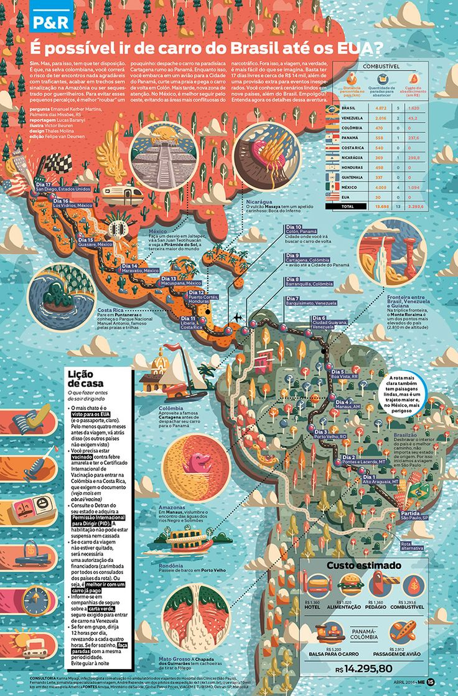

# P028-I01｜巴西至美国陆路旅行地理说明

## 原图与来源

- 案例编号：P028-I01；本库标题为检索描述，不自动视为原作正式名称。
- 来源：用户提供的《第三讲-信息图形类型学_PPT图片提取包.zip》，课件第 28 页、第 1 张图。
- 素材包原路径：`常用信息图形案例库/07-地标型信息图形Location Infographics/01-示例图/PPT第28页-图片01.jpg`。
- 原图：736×1117 像素，保留提取文件的原始字节；SHA-256：`9d4c49aac979ab12220aaa5b133a32c30f4c54412c20c2318bf987f1c951bbb6`。
- 作者、原始发表日期、数据原始出处：未独立核对，原图可见标识不自动等于作者署名。
- 本记录更新：2026-11-20；已核对可见画面结构并完成 A—E 分析，细小数值与原始数据仍以核对状态为准。

## 可直接观察的画面

南北美洲轮廓与沿途插画构成主画面，路线、地点、费用表和局部放大说明散布其上。

## A 基本的数据逻辑

起终点、通行路径、地点及旅程成本等属性共同组织。

## B 统计图形与计算

路线地图叠加费用和局部图解；底图未确认投影，不从插画比例计算路程。

## C 视觉编码

线标路线，符号标地标和交通情境，区域色与文字区分地点。

未在画面中建立明确数值映射的大小、颜色、纹理与立体效果，不据此反算数据；没有出现的视觉要素不强行补写。

## D 数据／信息架构

全局线路建立方位，局部故事和边栏表格补充旅程条件。

## E 视觉叙事架构

沿路径从起点到终点，逐段理解障碍与成本。

以上为根据编排作的阅读路径分析，不是经过眼动或记忆实验测得的结果。

## 边界、待核实项与方法修订

该图属于历史旅行题材分析，具体通行条件和费用不作为当前旅行依据。

本记录的画面描述属于直接观察；数据关系与叙事路径属于分析解释。原始统计表、作者意图和未辨清的微小标签不补造。新证据出现时同步修订此记录、类型方法和相关逻辑文档。

## 关联文档

[本类型说明与案例索引](README.md) · [全部常用类型](../README.md) · [来源与页码对照](../PDF对照与案例索引.md)

相关数据逻辑或判别边界：[地理图形信息图形概念定义](../../01-信息图形数据逻辑/05-地理图形信息图形概念定义.md) · [编目型信息图形概念定义](../../01-信息图形数据逻辑/03-编目型信息图形概念定义.md)。
