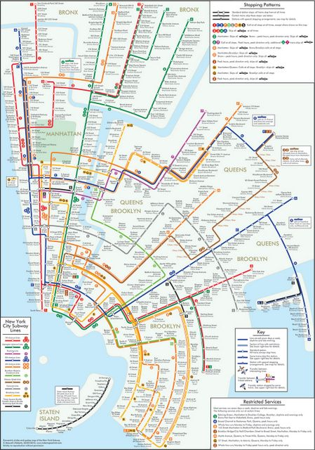

# P028-I02｜纽约地铁线路与站点示意图

## 原图与来源

- 案例编号：P028-I02；本库标题为检索描述，不自动视为原作正式名称。
- 来源：用户提供的《第三讲-信息图形类型学_PPT图片提取包.zip》，课件第 28 页、第 2 张图。
- 素材包原路径：`常用信息图形案例库/07-地标型信息图形Location Infographics/01-示例图/PPT第28页-图片02.jpg`。
- 原图：449×640 像素，保留提取文件的原始字节；SHA-256：`7c63cb0a86a84027449c3c3b9410e51fdbf7ce6119d7ffacf70bd9d0c2e0f19b`。
- 作者、原始发表日期、数据原始出处：未独立核对，原图可见标识不自动等于作者署名。
- 本记录更新：2026-11-20；已核对可见画面结构并完成 A—E 分析，细小数值与原始数据仍以核对状态为准。

## 可直接观察的画面

多色线路穿过城市区域，各线排列站名与换乘符号，右侧有线路、运行及限制说明。

## A 基本的数据逻辑

站点、线路、连接和换乘构成空间网络。

## B 统计图形与计算

拓扑路线图；线段长度不直接代表实际距离、乘车时间或班次。

## C 视觉编码

色彩区别线路，节点和特殊符号标识站点与换乘，文字承担名称导航。

未在画面中建立明确数值映射的大小、颜色、纹理与立体效果，不据此反算数据；没有出现的视觉要素不强行补写。

## D 数据／信息架构

主网图与服务图例分工，局部支线和说明补充主网络。

## E 视觉叙事架构

按起点定位线路，经换乘寻找目的地，主要服务检索而非单向故事。

以上为根据编排作的阅读路径分析，不是经过眼动或记忆实验测得的结果。

## 边界、待核实项与方法修订

原图网络和服务规则可能为旧版本；本记录分析编码方法，不据此提供实时乘车建议。

本记录的画面描述属于直接观察；数据关系与叙事路径属于分析解释。原始统计表、作者意图和未辨清的微小标签不补造。新证据出现时同步修订此记录、类型方法和相关逻辑文档。

## 关联文档

[本类型说明与案例索引](README.md) · [全部常用类型](../README.md) · [来源与页码对照](../PDF对照与案例索引.md)

相关数据逻辑或判别边界：[地理图形信息图形概念定义](../../01-信息图形数据逻辑/05-地理图形信息图形概念定义.md)。
