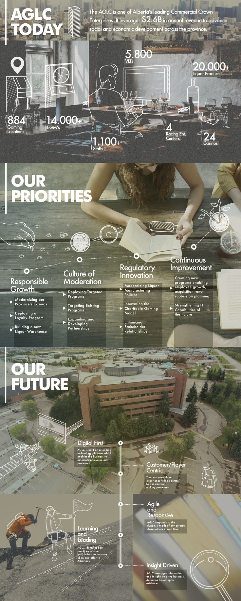

# P029-I01｜机构现状、重点与未来的照片信息长图

## 原图与来源

- 案例编号：P029-I01；本库标题为检索描述，不自动视为原作正式名称。
- 来源：用户提供的《第三讲-信息图形类型学_PPT图片提取包.zip》，课件第 29 页、第 1 张图。
- 素材包原路径：`常用信息图形案例库/08-图片式信息图形Photo-graphic Infographics/01-示例图/PPT第29页-图片01.jpg`。
- 原图：736×1827 像素，保留提取文件的原始字节；SHA-256：`fbc18bb372f12701b32d330deff5ebdc51362de8e341f641f1441a46119cedc8`。
- 作者、原始发表日期、数据原始出处：未独立核对，原图可见标识不自动等于作者署名。
- 本记录更新：2026-11-20；已核对可见画面结构并完成 A—E 分析，细小数值与原始数据仍以核对状态为准。

## 可直接观察的画面

长版面按 Today、Our Priorities、Our Future 分区，建筑及人物照片上覆盖白色图标、数字、线条和短文。

## A 基本的数据逻辑

机构信息按现状、重点和未来规划分组。

## B 统计图形与计算

照片叠加数字说明与图解，未见统一统计坐标；未来画面属于规划表达。

## C 视觉编码

照片提供实景，白色符号和引线定位说明，大标题构成段落层级。

未在画面中建立明确数值映射的大小、颜色、纹理与立体效果，不据此反算数据；没有出现的视觉要素不强行补写。

## D 数据／信息架构

三个大段落组成概要到展望的信息结构。

## E 视觉叙事架构

由现状介绍进入建设重点，最后到未来愿景。

以上为根据编排作的阅读路径分析，不是经过眼动或记忆实验测得的结果。

## 边界、待核实项与方法修订

写在照片上的数值仍需各自单位与出处；照片本身不能证明规划已实现。

本记录的画面描述属于直接观察；数据关系与叙事路径属于分析解释。原始统计表、作者意图和未辨清的微小标签不补造。新证据出现时同步修订此记录、类型方法和相关逻辑文档。

## 关联文档

[本类型说明与案例索引](README.md) · [全部常用类型](../README.md) · [来源与页码对照](../PDF对照与案例索引.md)

相关数据逻辑或判别边界：[编目型信息图形概念定义](../../01-信息图形数据逻辑/03-编目型信息图形概念定义.md) · [编年型信息图形概念定义](../../01-信息图形数据逻辑/01-编年型信息图形概念定义.md)。
