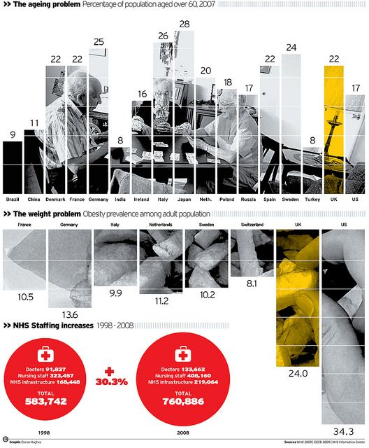

# P029-I02｜老龄化、体重与医疗人员照片统计图

## 原图与来源

- 案例编号：P029-I02；本库标题为检索描述，不自动视为原作正式名称。
- 来源：用户提供的《第三讲-信息图形类型学_PPT图片提取包.zip》，课件第 29 页、第 2 张图。
- 素材包原路径：`常用信息图形案例库/08-图片式信息图形Photo-graphic Infographics/01-示例图/PPT第29页-图片02.jpg`。
- 原图：528×640 像素，保留提取文件的原始字节；SHA-256：`5cc98c3c9a7bb20b9f32e6a3fce3332c0e5c8d76c384bc528075427686986ca8`。
- 作者、原始发表日期、数据原始出处：未独立核对，原图可见标识不自动等于作者署名。
- 本记录更新：2026-11-20；已核对可见画面结构并完成 A—E 分析，细小数值与原始数据仍以核对状态为准。

## 可直接观察的画面

上部为各国老龄人口柱形并叠人物照片，中部为肥胖指标图，下部用红色圆形比较医疗人员。

## A 基本的数据逻辑

国家、健康指标和不同时期人员数量的多组比较。

## B 统计图形与计算

柱形及圆形比较；年龄结构、体重与人员总数单位不同，分别阅读。

## C 视觉编码

照片被裁入图形以解释主题，黑灰与黄色形成重点，红色圆形用于另一个模块。

未在画面中建立明确数值映射的大小、颜色、纹理与立体效果，不据此反算数据；没有出现的视觉要素不强行补写。

## D 数据／信息架构

按老龄化、体重问题和人员变化分成三个主题。

## E 视觉叙事架构

先读照片化比较，再转入相关医疗资源背景。

以上为根据编排作的阅读路径分析，不是经过眼动或记忆实验测得的结果。

## 边界、待核实项与方法修订

图像裁切不能改变统计高度；圆面积映射、数据年份与口径需逐项核对。

本记录的画面描述属于直接观察；数据关系与叙事路径属于分析解释。原始统计表、作者意图和未辨清的微小标签不补造。新证据出现时同步修订此记录、类型方法和相关逻辑文档。

## 关联文档

[本类型说明与案例索引](README.md) · [全部常用类型](../README.md) · [来源与页码对照](../PDF对照与案例索引.md)

相关数据逻辑或判别边界：[编目型信息图形概念定义](../../01-信息图形数据逻辑/03-编目型信息图形概念定义.md)。
