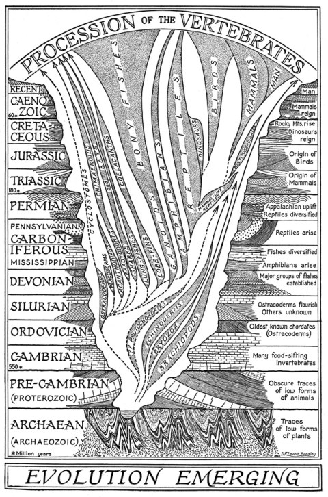

# P006-I01｜脊椎动物演化分支与地质时期图

## 原图与来源

- 案例编号：P006-I01；本库标题为检索描述，不自动视为原作正式名称。
- 来源：用户提供的《第三讲-信息图形类型学_PPT图片提取包.zip》，课件第 6 页、第 1 张图。
- 素材包原路径：`02-层级型信息图形Hierarchical Infographics/01-示例图/PPT第06页-图片01.jpg`。
- 原图：480×726 像素，保留提取文件的原始字节；SHA-256：`1e7c318f29db529c1ffc7746f7dbdd8d76525d1a9e8eefced1085a80a15ff9b2`。
- 作者、原始发表日期、数据原始出处：未独立核对，原图可见标识不自动等于作者署名。
- 本记录更新：2026-11-20；已核对可见画面结构并完成 A—E 分析，细小数值与原始数据仍以核对状态为准。

## 可直接观察的画面

黑白画面中，多条从底部展开的宽分支向顶部延伸，两侧按地质时期和说明排列文字，底部可见 Evolution Emerging。

## A 基本的数据逻辑

演化分支、类群与地质时期叠加；属于结构层级与编年背景的组合。

## B 统计图形与计算

分支示意与时期分带，未见把分支宽度标为物种数量的量尺。

## C 视觉编码

线与带表示分支延续，文字定位类群与时期，黑白纹理辅助区分区域。

未在画面中建立明确数值映射的大小、颜色、纹理与立体效果，不据此反算数据；没有出现的视觉要素不强行补写。

## D 数据／信息架构

根部到分支总体结构、两侧时期标签与局部注释互补。

## E 视觉叙事架构

从根部理解分化，并结合地质背景阅读各分支。

以上为根据编排作的阅读路径分析，不是经过眼动或记忆实验测得的结果。

## 边界、待核实项与方法修订

历史演化图属于特定知识语境，不作为当前分类学定论；分支宽度不自行量化。

本记录的画面描述属于直接观察；数据关系与叙事路径属于分析解释。原始统计表、作者意图和未辨清的微小标签不补造。新证据出现时同步修订此记录、类型方法和相关逻辑文档。

## 关联文档

[本类型说明与案例索引](README.md) · [全部常用类型](../README.md) · [来源与页码对照](../PDF对照与案例索引.md)

相关数据逻辑或判别边界：[层级型信息图形概念定义](../../01-信息图形数据逻辑/02-层级型信息图形概念定义.md) · [编年型信息图形概念定义](../../01-信息图形数据逻辑/01-编年型信息图形概念定义.md)。
