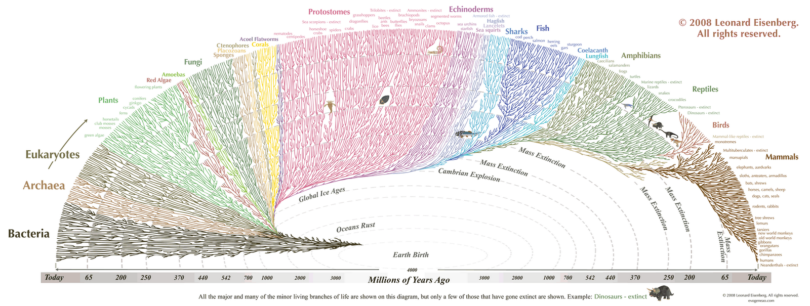

# P008-I01｜扇形生命演化分支图

## 原图与来源

- 案例编号：P008-I01；本库标题为检索描述，不自动视为原作正式名称。
- 来源：用户提供的《第三讲-信息图形类型学_PPT图片提取包.zip》，课件第 8 页、第 1 张图。
- 素材包原路径：`02-层级型信息图形Hierarchical Infographics/01-示例图/PPT第08页-图片01.png`。
- 原图：1600×605 像素，保留提取文件的原始字节；SHA-256：`d7fc5defd608be31f99ce4f0a34a694b07e0aec539634a732707acf13639c0c9`。
- 作者、原始发表日期、数据原始出处：未独立核对，原图可见标识不自动等于作者署名。
- 本记录更新：2026-11-20；已核对可见画面结构并完成 A—E 分析，细小数值与原始数据仍以核对状态为准。

## 可直接观察的画面

多色细线从扇形底部向外分叉，外围标注生物类群，底部含年代刻度。

## A 基本的数据逻辑

亲缘分支与共同祖先组织结构，时间提供另一维背景。

## B 统计图形与计算

扇形树状连接图叠加时间刻度；角度与扇面面积未确认编码丰度。

## C 视觉编码

连线编码分支，颜色区分类群，文字与刻度帮助定位。

未在画面中建立明确数值映射的大小、颜色、纹理与立体效果，不据此反算数据；没有出现的视觉要素不强行补写。

## D 数据／信息架构

整体扇面给总览，外圈名称与底部年代支持局部阅读。

## E 视觉叙事架构

先识别主要类群，再沿分叉向内回溯或从祖先向外展开。

以上为根据编排作的阅读路径分析，不是经过眼动或记忆实验测得的结果。

## 边界、待核实项与方法修订

不能把扇区大直接解释成物种多或更高级；需核对图例与原始系统发育依据。

本记录的画面描述属于直接观察；数据关系与叙事路径属于分析解释。原始统计表、作者意图和未辨清的微小标签不补造。新证据出现时同步修订此记录、类型方法和相关逻辑文档。

## 关联文档

[本类型说明与案例索引](README.md) · [全部常用类型](../README.md) · [来源与页码对照](../PDF对照与案例索引.md)

相关数据逻辑或判别边界：[层级型信息图形概念定义](../../01-信息图形数据逻辑/02-层级型信息图形概念定义.md) · [编年型信息图形概念定义](../../01-信息图形数据逻辑/01-编年型信息图形概念定义.md)。
