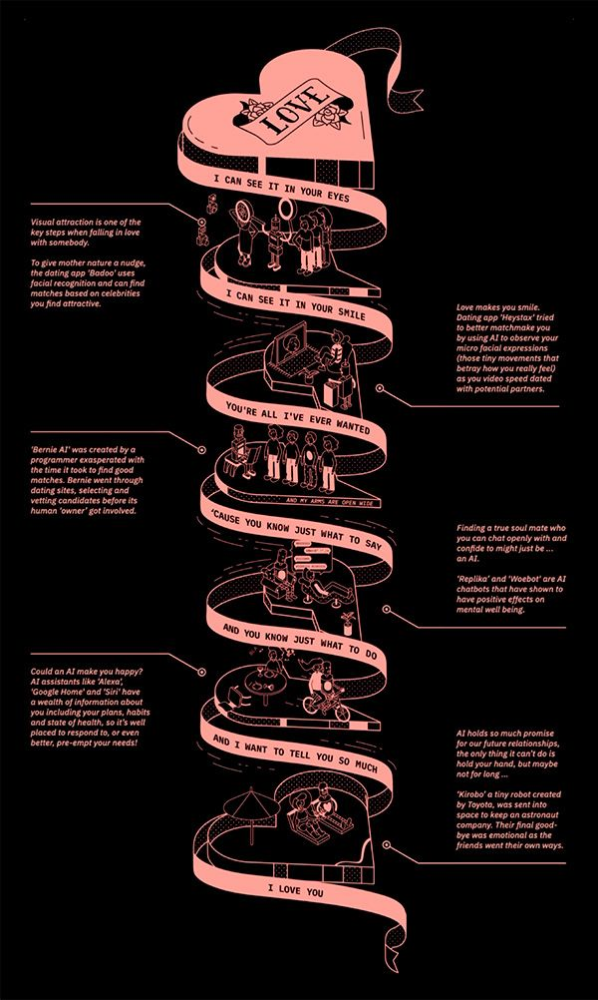

# P030-I01｜爱情主题丝带式阶段说明

## 原图与来源

- 案例编号：P030-I01；本库标题为检索描述，不自动视为原作正式名称。
- 来源：用户提供的《第三讲-信息图形类型学_PPT图片提取包.zip》，课件第 30 页、第 1 张图。
- 素材包原路径：`常用信息图形案例库/09-层级型信息图形Hierarchical Infographics/01-示例图/PPT第30页-图片01.jpg`。
- 原图：600×1002 像素，保留提取文件的原始字节；SHA-256：`ac10c8e2efdeba9138ad8f3e9c8af3b905b6e3b65e47680c7a2426286756b4e5`。
- 作者、原始发表日期、数据原始出处：未独立核对，原图可见标识不自动等于作者署名。
- 本记录更新：2026-11-20；已核对可见画面结构并完成 A—E 分析，细小数值与原始数据仍以核对状态为准。

## 可直接观察的画面

粉色丝带从顶部心形向下盘旋，穿过人物和情境插画，左右有文字引线；未见父子分叉。

## A 基本的数据逻辑

阶段／主题条目沿单条路径串联，未观察到严格的层级树。

## B 统计图形与计算

未见统计轴；丝带宽度、圈数和插画大小不作为数据量。

## C 视觉编码

心形与人物传达主题，丝带引导连续阅读，引线将解释与局部场景对应。

未在画面中建立明确数值映射的大小、颜色、纹理与立体效果，不据此反算数据；没有出现的视觉要素不强行补写。

## D 数据／信息架构

中央情境链与两侧解释交替组成版面。

## E 视觉叙事架构

沿盘旋路径逐段阅读主题说明。

以上为根据编排作的阅读路径分析，不是经过眼动或记忆实验测得的结果。

## 边界、待核实项与方法修订

保留课件层级型归类，同时标为边界案例：单向路径和视觉高低不足以证明父子层级。

本记录的画面描述属于直接观察；数据关系与叙事路径属于分析解释。原始统计表、作者意图和未辨清的微小标签不补造。新证据出现时同步修订此记录、类型方法和相关逻辑文档。

## 关联文档

[本类型说明与案例索引](README.md) · [全部常用类型](../README.md) · [来源与页码对照](../PDF对照与案例索引.md)

相关数据逻辑或判别边界：[层级型信息图形概念定义](../../01-信息图形数据逻辑/02-层级型信息图形概念定义.md) · [编目型信息图形概念定义](../../01-信息图形数据逻辑/03-编目型信息图形概念定义.md)。
