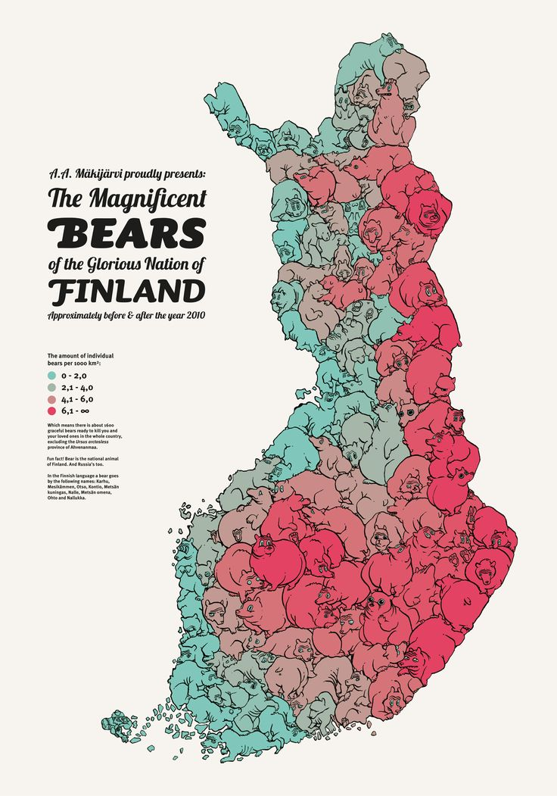

# P030-I02｜芬兰熊分布的象形分级地图

## 原图与来源

- 案例编号：P030-I02；本库标题为检索描述，不自动视为原作正式名称。
- 来源：用户提供的《第三讲-信息图形类型学_PPT图片提取包.zip》，课件第 30 页、第 2 张图。
- 素材包原路径：`常用信息图形案例库/09-层级型信息图形Hierarchical Infographics/01-示例图/PPT第30页-图片02.jpg`。
- 原图：736×1051 像素，保留提取文件的原始字节；SHA-256：`f87d5b9b4c131fea462d4ccc230c02445044e24c9a9a81407995164da6827dcb`。
- 作者、原始发表日期、数据原始出处：未独立核对，原图可见标识不自动等于作者署名。
- 本记录更新：2026-11-20；已核对可见画面结构并完成 A—E 分析，细小数值与原始数据仍以核对状态为准。

## 可直接观察的画面

芬兰轮廓由不同颜色和大小的熊形填充，左侧色标说明每1000平方公里的熊数量分组，标题提到2010。

## A 基本的数据逻辑

区域位置与熊密度分组构成主逻辑，另含等级色阶。

## B 统计图形与计算

分级设色地图；色阶表示密度区间，熊形大小未见独立量值标定。

## C 视觉编码

区域面被熊形象形化，色相／明度表示密度等级，边界保持空间轮廓。

未在画面中建立明确数值映射的大小、颜色、纹理与立体效果，不据此反算数据；没有出现的视觉要素不强行补写。

## D 数据／信息架构

左侧标题、读法与图例，右侧地图提供空间分布。

## E 视觉叙事架构

先理解密度图例，再寻找地图中颜色集中的区域。

以上为根据编排作的阅读路径分析，不是经过眼动或记忆实验测得的结果。

## 边界、待核实项与方法修订

课件将其放在层级型页，但主逻辑是地理；密度等级不等于父子树，不按熊插画数推断总量。

本记录的画面描述属于直接观察；数据关系与叙事路径属于分析解释。原始统计表、作者意图和未辨清的微小标签不补造。新证据出现时同步修订此记录、类型方法和相关逻辑文档。

## 关联文档

[本类型说明与案例索引](README.md) · [全部常用类型](../README.md) · [来源与页码对照](../PDF对照与案例索引.md)

相关数据逻辑或判别边界：[地理图形信息图形概念定义](../../01-信息图形数据逻辑/05-地理图形信息图形概念定义.md) · [层级型信息图形概念定义](../../01-信息图形数据逻辑/02-层级型信息图形概念定义.md)。
