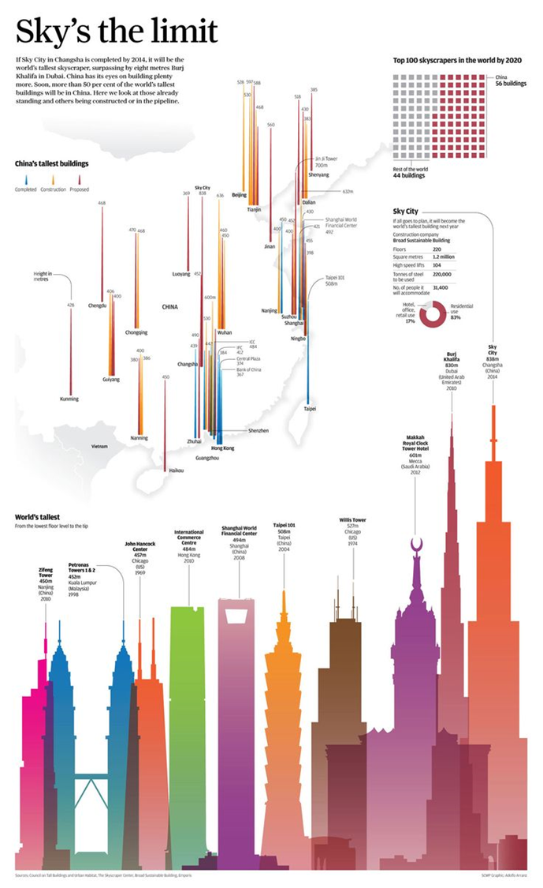

# P031-I01｜世界高层建筑高度比较

## 原图与来源

- 案例编号：P031-I01；本库标题为检索描述，不自动视为原作正式名称。
- 来源：用户提供的《第三讲-信息图形类型学_PPT图片提取包.zip》，课件第 31 页、第 1 张图。
- 素材包原路径：`常用信息图形案例库/10-单一图表型信息图形Single Chart/01-示例图/PPT第31页-图片01.png`。
- 原图：689×1125 像素，保留提取文件的原始字节；SHA-256：`0db117bcd6387eefa03591910c3ca80204a6c6eabaf81f496aa236e28564d239`。
- 作者、原始发表日期、数据原始出处：未独立核对，原图可见标识不自动等于作者署名。
- 本记录更新：2026-11-20；已核对可见画面结构并完成 A—E 分析，细小数值与原始数据仍以核对状态为准。

## 可直接观察的画面

上部多条细长柱和标签叠在淡色地图上，下部用不同颜色建筑轮廓按高度并置，旁有补充计数。

## A 基本的数据逻辑

城市／建筑与高度、数量属性的比较集合。

## B 统计图形与计算

高度比较及辅助计数；轮廓若按比例应共享基准，具体单位与截断需核对。

## C 视觉编码

竖向长度与建筑轮廓传达高度，色彩区分对象，地图提供背景。

未在画面中建立明确数值映射的大小、颜色、纹理与立体效果，不据此反算数据；没有出现的视觉要素不强行补写。

## D 数据／信息架构

上方分布与指标概览，下方同基线轮廓便于直观比较。

## E 视觉叙事架构

从标题提出高度问题，再由大轮廓比较进入细标签。

以上为根据编排作的阅读路径分析，不是经过眼动或记忆实验测得的结果。

## 边界、待核实项与方法修订

课件列单一图表型，但页面含辅助组件；“单一”应指主比较图，而非绝无其他图。

本记录的画面描述属于直接观察；数据关系与叙事路径属于分析解释。原始统计表、作者意图和未辨清的微小标签不补造。新证据出现时同步修订此记录、类型方法和相关逻辑文档。

## 关联文档

[本类型说明与案例索引](README.md) · [全部常用类型](../README.md) · [来源与页码对照](../PDF对照与案例索引.md)

相关数据逻辑或判别边界：[编目型信息图形概念定义](../../01-信息图形数据逻辑/03-编目型信息图形概念定义.md) · [地理图形信息图形概念定义](../../01-信息图形数据逻辑/05-地理图形信息图形概念定义.md)。
