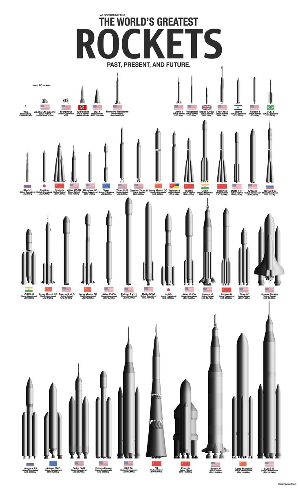

# P031-I02｜世界火箭型号排列比较

## 原图与来源

- 案例编号：P031-I02；本库标题为检索描述，不自动视为原作正式名称。
- 来源：用户提供的《第三讲-信息图形类型学_PPT图片提取包.zip》，课件第 31 页、第 2 张图。
- 素材包原路径：`常用信息图形案例库/10-单一图表型信息图形Single Chart/01-示例图/PPT第31页-图片02.jpg`。
- 原图：736×1193 像素，保留提取文件的原始字节；SHA-256：`cfafd8265c3c672845c1348aed2c3c0e2d0d4ea1bfcd3d8da5a643c2107b6f29`。
- 作者、原始发表日期、数据原始出处：未独立核对，原图可见标识不自动等于作者署名。
- 本记录更新：2026-11-20；已核对可见画面结构并完成 A—E 分析，细小数值与原始数据仍以核对状态为准。

## 可直接观察的画面

白底上多排火箭轮廓，旁有名称和小国旗，标题为世界火箭的过去、现在和未来。

## A 基本的数据逻辑

火箭型号、国家和时代属性的编目集合。

## B 统计图形与计算

轮廓阵列式比较；图中名称与模型可读，完整尺寸标尺仍待核对。

## C 视觉编码

轮廓识别型号，国旗表达国家，多排重复布局组织条目。

未在画面中建立明确数值映射的大小、颜色、纹理与立体效果，不据此反算数据；没有出现的视觉要素不强行补写。

## D 数据／信息架构

大标题限定主题，阵列提供总览，每项小标签给细节。

## E 视觉叙事架构

通过形态和大小建立整体印象，再定位具体型号。

以上为根据编排作的阅读路径分析，不是经过眼动或记忆实验测得的结果。

## 边界、待核实项与方法修订

统一绘图比例若未确认，不能用像素量身高；标题含时代词不等于已存在可量化时间轴。

本记录的画面描述属于直接观察；数据关系与叙事路径属于分析解释。原始统计表、作者意图和未辨清的微小标签不补造。新证据出现时同步修订此记录、类型方法和相关逻辑文档。

## 关联文档

[本类型说明与案例索引](README.md) · [全部常用类型](../README.md) · [来源与页码对照](../PDF对照与案例索引.md)

相关数据逻辑或判别边界：[编目型信息图形概念定义](../../01-信息图形数据逻辑/03-编目型信息图形概念定义.md)。
