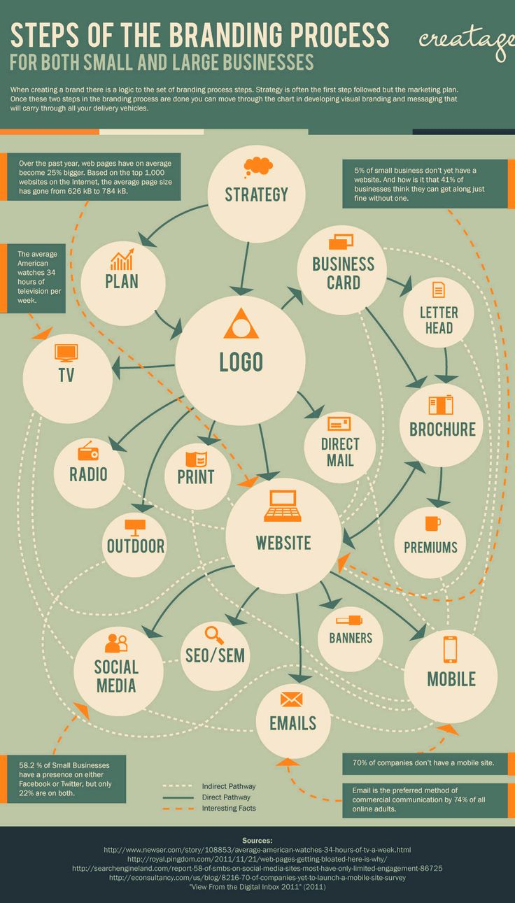

# P032-I01｜品牌设计流程的文字节点网络

## 原图与来源

- 案例编号：P032-I01；本库标题为检索描述，不自动视为原作正式名称。
- 来源：用户提供的《第三讲-信息图形类型学_PPT图片提取包.zip》，课件第 32 页、第 1 张图。
- 素材包原路径：`常用信息图形案例库/11-可视化文本Visualized Text/01-示例图/PPT第32页-图片01.jpg`。
- 原图：736×1291 像素，保留提取文件的原始字节；SHA-256：`2caf29cc31ada5a67fd72b8a43977ceb5f4408dc94c46d80724fe9b5c7891dbb`。
- 作者、原始发表日期、数据原始出处：未独立核对，原图可见标识不自动等于作者署名。
- 本记录更新：2026-11-20；已核对可见画面结构并完成 A—E 分析，细小数值与原始数据仍以核对状态为准。

## 可直接观察的画面

绿色长版面中，Logo 为中央圆节点，策略、名片、网站、社交媒体等圆节点以线和箭头连接，顶部与底部有文字。

## A 基本的数据逻辑

品牌传播组件与工作关系的概念网络。

## B 统计图形与计算

节点网络而非词频统计；圆形大小未见量值标尺。

## C 视觉编码

词语置入圆面成为节点，图标辅助类别，线和箭头给关系，字号区分入口。

未在画面中建立明确数值映射的大小、颜色、纹理与立体效果，不据此反算数据；没有出现的视觉要素不强行补写。

## D 数据／信息架构

中心概念、周围组件与补充说明形成层次。

## E 视觉叙事架构

从中心词进入，再沿连接理解不同传播载体。

以上为根据编排作的阅读路径分析，不是经过眼动或记忆实验测得的结果。

## 边界、待核实项与方法修订

文字可视化不必是词云，也不自动属于字母表型；这里未见A—Z组织。

本记录的画面描述属于直接观察；数据关系与叙事路径属于分析解释。原始统计表、作者意图和未辨清的微小标签不补造。新证据出现时同步修订此记录、类型方法和相关逻辑文档。

## 关联文档

[本类型说明与案例索引](README.md) · [全部常用类型](../README.md) · [来源与页码对照](../PDF对照与案例索引.md)

相关数据逻辑或判别边界：[编目型信息图形概念定义](../../01-信息图形数据逻辑/03-编目型信息图形概念定义.md) · [字母表型信息图形概念定义](../../01-信息图形数据逻辑/04-字母表型信息图形概念定义.md)。
