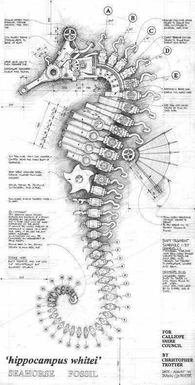

# P033-I01｜机械海马解剖式结构图

## 原图与来源

- 案例编号：P033-I01；本库标题为检索描述，不自动视为原作正式名称。
- 来源：用户提供的《第三讲-信息图形类型学_PPT图片提取包.zip》，课件第 33 页、第 1 张图。
- 素材包原路径：`常用信息图形案例库/12-解剖型信息图形Anatomical/01-示例图/PPT第33页-图片01.jpg`。
- 原图：400×787 像素，保留提取文件的原始字节；SHA-256：`1a242121e3d80cc420fc2cc7ae9d49565a106fdd0864f6f2d924249ddea2000f`。
- 作者、原始发表日期、数据原始出处：未独立核对，原图可见标识不自动等于作者署名。
- 本记录更新：2026-11-20；已核对可见画面结构并完成 A—E 分析，细小数值与原始数据仍以核对状态为准。

## 可直接观察的画面

黑白机械海马占据中央，多条引线指向齿轮、关节和内部构件，底部另有圆形局部图。

## A 基本的数据逻辑

虚构机械对象与部件的组成关系。

## B 统计图形与计算

剖面及部件说明图；未见可用于实物制造的比例和公差。

## C 视觉编码

点位与引线定位部件，黑白线条区分轮廓、剖面和文字。

未在画面中建立明确数值映射的大小、颜色、纹理与立体效果，不据此反算数据；没有出现的视觉要素不强行补写。

## D 数据／信息架构

主体总览、周边部件名称与底部局部细节共同说明结构。

## E 视觉叙事架构

从整体物象进入局部机制，再回到部件如何共同组成主体。

以上为根据编排作的阅读路径分析，不是经过眼动或记忆实验测得的结果。

## 边界、待核实项与方法修订

是解剖式说明的视觉案例，不将虚构机械构造写成真实生物解剖事实。

本记录的画面描述属于直接观察；数据关系与叙事路径属于分析解释。原始统计表、作者意图和未辨清的微小标签不补造。新证据出现时同步修订此记录、类型方法和相关逻辑文档。

## 关联文档

[本类型说明与案例索引](README.md) · [全部常用类型](../README.md) · [来源与页码对照](../PDF对照与案例索引.md)

相关数据逻辑或判别边界：[层级型信息图形概念定义](../../01-信息图形数据逻辑/02-层级型信息图形概念定义.md) · [编目型信息图形概念定义](../../01-信息图形数据逻辑/03-编目型信息图形概念定义.md)。
