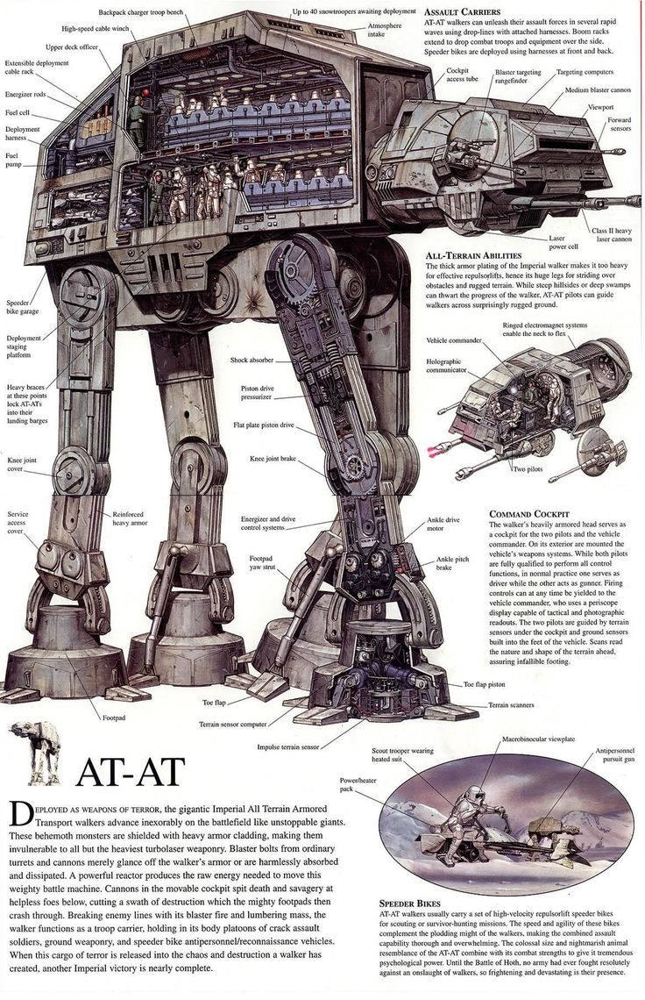

# P033-I02｜AT-AT步行机剖面结构说明

## 原图与来源

- 案例编号：P033-I02；本库标题为检索描述，不自动视为原作正式名称。
- 来源：用户提供的《第三讲-信息图形类型学_PPT图片提取包.zip》，课件第 33 页、第 2 张图。
- 素材包原路径：`常用信息图形案例库/12-解剖型信息图形Anatomical/01-示例图/PPT第33页-图片02.jpg`。
- 原图：736×1140 像素，保留提取文件的原始字节；SHA-256：`25c4e79e68e9916ab75d27b03e3417042ac9e871cbf191bc855df980e39843ea`。
- 作者、原始发表日期、数据原始出处：未独立核对，原图可见标识不自动等于作者署名。
- 本记录更新：2026-11-20；已核对可见画面结构并完成 A—E 分析，细小数值与原始数据仍以核对状态为准。

## 可直接观察的画面

大型步行机以剖开外壳展示内部空间，周围布满部件引线，右侧和底部含局部细节图。

## A 基本的数据逻辑

虚构载具的整体、舱室和构件关系。

## B 统计图形与计算

剖面总图与局部放大图；未确认量尺，部件位置不用于反算实物尺寸。

## C 视觉编码

外壳与剖面区分内外，细线连接标签，体积与遮挡建立空间理解。

未在画面中建立明确数值映射的大小、颜色、纹理与立体效果，不据此反算数据；没有出现的视觉要素不强行补写。

## D 数据／信息架构

主结构图居中，旁边分解局部与功能说明。

## E 视觉叙事架构

先识别整体载具，再沿引线进入内部区域与细部。

以上为根据编排作的阅读路径分析，不是经过眼动或记忆实验测得的结果。

## 边界、待核实项与方法修订

虚构设定不作为工程规格；示意结构、说明文案和定量测绘必须区分。

本记录的画面描述属于直接观察；数据关系与叙事路径属于分析解释。原始统计表、作者意图和未辨清的微小标签不补造。新证据出现时同步修订此记录、类型方法和相关逻辑文档。

## 关联文档

[本类型说明与案例索引](README.md) · [全部常用类型](../README.md) · [来源与页码对照](../PDF对照与案例索引.md)

相关数据逻辑或判别边界：[层级型信息图形概念定义](../../01-信息图形数据逻辑/02-层级型信息图形概念定义.md) · [编目型信息图形概念定义](../../01-信息图形数据逻辑/03-编目型信息图形概念定义.md)。
