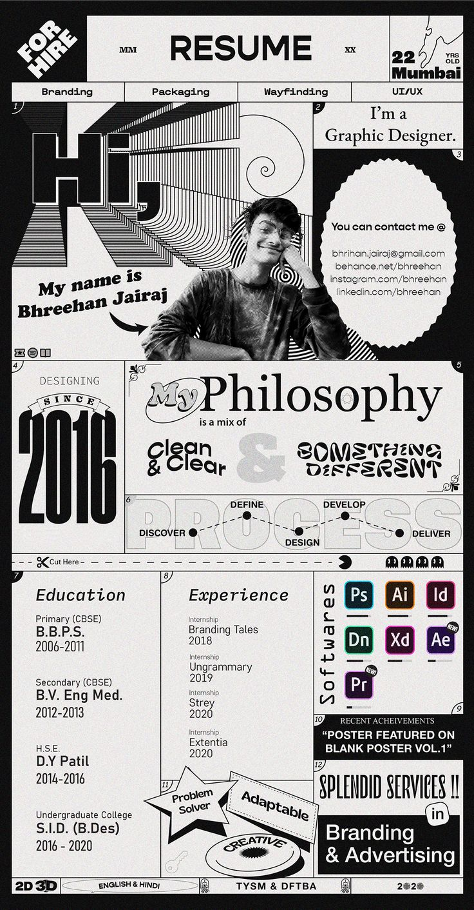

# P034-I01｜黑白拼贴式设计师简历

## 原图与来源

- 案例编号：P034-I01；本库标题为检索描述，不自动视为原作正式名称。
- 来源：用户提供的《第三讲-信息图形类型学_PPT图片提取包.zip》，课件第 34 页、第 1 张图。
- 素材包原路径：`常用信息图形案例库/13-可视化简历Visual Resume/01-示例图/PPT第34页-图片01.jpg`。
- 原图：736×1411 像素，保留提取文件的原始字节；SHA-256：`e67397166742945f24efb8ab26d8edc5bd1ea957b60f694952fbc98ea341982e`。
- 作者、原始发表日期、数据原始出处：未独立核对，原图可见标识不自动等于作者署名。
- 本记录更新：2026-11-20；已核对可见画面结构并完成 A—E 分析，细小数值与原始数据仍以核对状态为准。

## 可直接观察的画面

黑白版面集合 Resume、姓名、肖像、教育、经验、设计过程与软件符号，字体和框线具有强烈变化。

## A 基本的数据逻辑

个人身份、教育经历、工作经验和技能的多表集合。

## B 统计图形与计算

以信息编排为主，年份提供经历次序，软件符号不是标准化能力测量。

## C 视觉编码

大字标题与字重建立入口，线框划分模块，肖像提供身份识别。

未在画面中建立明确数值映射的大小、颜色、纹理与立体效果，不据此反算数据；没有出现的视觉要素不强行补写。

## D 数据／信息架构

身份概要、联系渠道、理念、教育与经验并列。

## E 视觉叙事架构

先被姓名与设计风格吸引，再按招聘问题查找经历和能力。

以上为根据编排作的阅读路径分析，不是经过眼动或记忆实验测得的结果。

## 边界、待核实项与方法修订

装饰字会影响扫描效率；个人信息与历史经历按原图语境分析，不推断现状。

本记录的画面描述属于直接观察；数据关系与叙事路径属于分析解释。原始统计表、作者意图和未辨清的微小标签不补造。新证据出现时同步修订此记录、类型方法和相关逻辑文档。

## 关联文档

[本类型说明与案例索引](README.md) · [全部常用类型](../README.md) · [来源与页码对照](../PDF对照与案例索引.md)

相关数据逻辑或判别边界：[编年型信息图形概念定义](../../01-信息图形数据逻辑/01-编年型信息图形概念定义.md) · [编目型信息图形概念定义](../../01-信息图形数据逻辑/03-编目型信息图形概念定义.md)。
