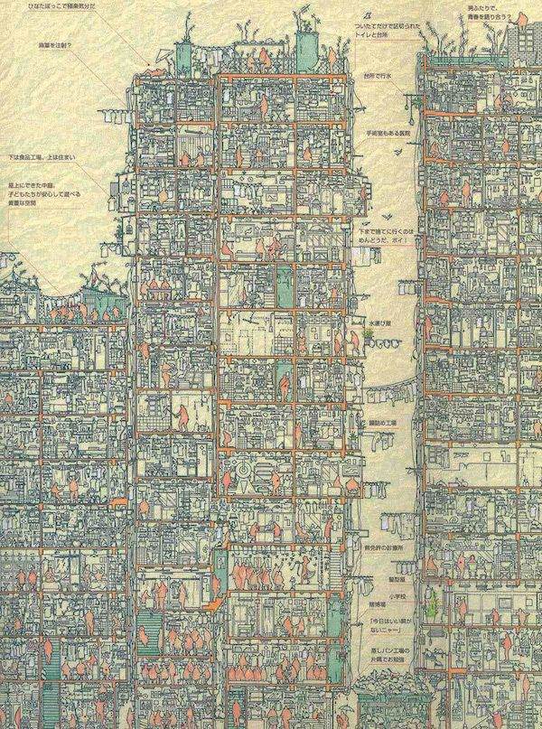

# P035-I01｜密集城市建筑的手绘剖面图

## 原图与来源

- 案例编号：P035-I01；本库标题为检索描述，不自动视为原作正式名称。
- 来源：用户提供的《第三讲-信息图形类型学_PPT图片提取包.zip》，课件第 35 页、第 1 张图。
- 素材包原路径：`常用信息图形案例库/14-手稿型信息图形Manuscript Infographics/01-示例图/PPT第35页-图片01.jpg`。
- 原图：600×807 像素，保留提取文件的原始字节；SHA-256：`d5c5efa0d11d4959b7b8d88c6c165762dc266c5deb2d5371bbbe0ea4564d3526`。
- 作者、原始发表日期、数据原始出处：未独立核对，原图可见标识不自动等于作者署名。
- 本记录更新：2026-11-20；已核对可见画面结构并完成 A—E 分析，细小数值与原始数据仍以核对状态为准。

## 可直接观察的画面

纵向密集建筑由大量细线、小房间和人物场景构成，旁有多处手写式标注，纸张背景偏暖。

## A 基本的数据逻辑

建筑空间、楼层、房间与活动的复合组织。

## B 统计图形与计算

手绘建筑剖面和情境说明；未观察到可核定的完整量尺。

## C 视觉编码

线条密度表达空间细节，剖面面域区分房间，人物提供活动语境。

未在画面中建立明确数值映射的大小、颜色、纹理与立体效果，不据此反算数据；没有出现的视觉要素不强行补写。

## D 数据／信息架构

整体建筑与局部标注分工，允许按空间位置探索。

## E 视觉叙事架构

先被密集总貌吸引，再逐层发现局部生活和结构。

以上为根据编排作的阅读路径分析，不是经过眼动或记忆实验测得的结果。

## 边界、待核实项与方法修订

手绘风格不是数据关系本身；不能把细节多等同于数据充分或真实测绘。

本记录的画面描述属于直接观察；数据关系与叙事路径属于分析解释。原始统计表、作者意图和未辨清的微小标签不补造。新证据出现时同步修订此记录、类型方法和相关逻辑文档。

## 关联文档

[本类型说明与案例索引](README.md) · [全部常用类型](../README.md) · [来源与页码对照](../PDF对照与案例索引.md)

相关数据逻辑或判别边界：[层级型信息图形概念定义](../../01-信息图形数据逻辑/02-层级型信息图形概念定义.md) · [编目型信息图形概念定义](../../01-信息图形数据逻辑/03-编目型信息图形概念定义.md)。
