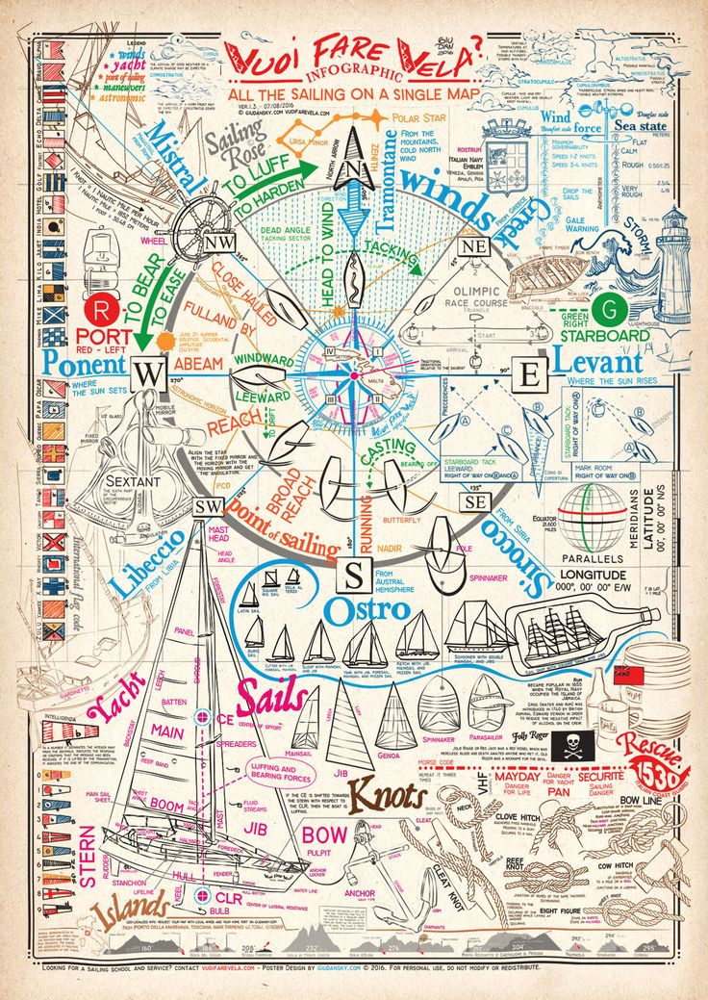

# P035-I02｜航海术语手绘知识图

## 原图与来源

- 案例编号：P035-I02；本库标题为检索描述，不自动视为原作正式名称。
- 来源：用户提供的《第三讲-信息图形类型学_PPT图片提取包.zip》，课件第 35 页、第 2 张图。
- 素材包原路径：`常用信息图形案例库/14-手稿型信息图形Manuscript Infographics/01-示例图/PPT第35页-图片02.jpg`。
- 原图：736×1039 像素，保留提取文件的原始字节；SHA-256：`be11203daf31061a593420a7743d4d5bd3f5e1b6f31bb866cd378dd20366695e`。
- 作者、原始发表日期、数据原始出处：未独立核对，原图可见标识不自动等于作者署名。
- 本记录更新：2026-11-20；已核对可见画面结构并完成 A—E 分析，细小数值与原始数据仍以核对状态为准。

## 可直接观察的画面

罗盘与方向字母在中央，帆船、绳结、风、海况和术语围绕分布，彩色文字与小图交错。

## A 基本的数据逻辑

航海主题概念、工具与操作词汇的多类编目。

## B 统计图形与计算

知识图解与局部示意组合，未见统一数值轴。

## C 视觉编码

手绘符号识别对象，文字方向与色彩帮助分组，局部箭头给方向关系。

未在画面中建立明确数值映射的大小、颜色、纹理与立体效果，不据此反算数据；没有出现的视觉要素不强行补写。

## D 数据／信息架构

中心方向系统连接外围主题，边缘小图补细节。

## E 视觉叙事架构

从熟悉的罗盘进入，再按兴趣探索帆、绳结等知识块。

以上为根据编排作的阅读路径分析，不是经过眼动或记忆实验测得的结果。

## 边界、待核实项与方法修订

字母表示方位，不据此判为字母表型；复杂手绘需要明确分组和索引。

本记录的画面描述属于直接观察；数据关系与叙事路径属于分析解释。原始统计表、作者意图和未辨清的微小标签不补造。新证据出现时同步修订此记录、类型方法和相关逻辑文档。

## 关联文档

[本类型说明与案例索引](README.md) · [全部常用类型](../README.md) · [来源与页码对照](../PDF对照与案例索引.md)

相关数据逻辑或判别边界：[编目型信息图形概念定义](../../01-信息图形数据逻辑/03-编目型信息图形概念定义.md) · [地理图形信息图形概念定义](../../01-信息图形数据逻辑/05-地理图形信息图形概念定义.md)。
