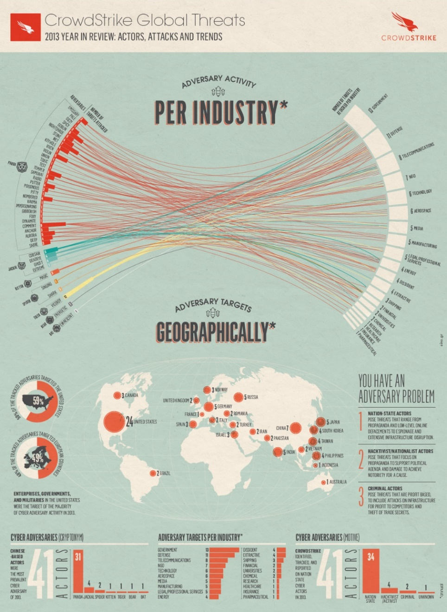

# P036-I01｜网络威胁按行业与地区的流向版式

## 原图与来源

- 案例编号：P036-I01；本库标题为检索描述，不自动视为原作正式名称。
- 来源：用户提供的《第三讲-信息图形类型学_PPT图片提取包.zip》，课件第 36 页、第 1 张图。
- 素材包原路径：`常用信息图形案例库/15-编年图与编目混合型信息图形Chronological-Cataloged Mixed/01-示例图/PPT第36页-图片01.jpg`。
- 原图：964×1317 像素，保留提取文件的原始字节；SHA-256：`34f3ac09fd52f1c7772cb22d5e820f5931694e533b2ef07723ba2a30a447ff7a`。
- 作者、原始发表日期、数据原始出处：未独立核对，原图可见标识不自动等于作者署名。
- 本记录更新：2026-11-20；已核对可见画面结构并完成 A—E 分析，细小数值与原始数据仍以核对状态为准。

## 可直接观察的画面

标题涉及2013年网络威胁；上部弧形两侧节点以彩色连线相接，下部有世界地图与小统计图。

## A 基本的数据逻辑

行为者、目标行业和地区属性的关系集合。

## B 统计图形与计算

关系／流向图、地图和小型条形图混合；连线粗细的量值定义待核对。

## C 视觉编码

彩色线区分类别或来源，节点提供关系端点，地图点位表示地区信息。

未在画面中建立明确数值映射的大小、颜色、纹理与立体效果，不据此反算数据；没有出现的视觉要素不强行补写。

## D 数据／信息架构

关系概览在上，地理分布和细分统计在下。

## E 视觉叙事架构

先了解谁与哪些行业相关，再查目标地区和细分频数。

以上为根据编排作的阅读路径分析，不是经过眼动或记忆实验测得的结果。

## 边界、待核实项与方法修订

虽位于编年＋编目页，目前只见年份标签，未见明确编年轴；作为分类边界案例保留。

本记录的画面描述属于直接观察；数据关系与叙事路径属于分析解释。原始统计表、作者意图和未辨清的微小标签不补造。新证据出现时同步修订此记录、类型方法和相关逻辑文档。

## 关联文档

[本类型说明与案例索引](README.md) · [全部常用类型](../README.md) · [来源与页码对照](../PDF对照与案例索引.md)

相关数据逻辑或判别边界：[编目型信息图形概念定义](../../01-信息图形数据逻辑/03-编目型信息图形概念定义.md) · [地理图形信息图形概念定义](../../01-信息图形数据逻辑/05-地理图形信息图形概念定义.md)。
