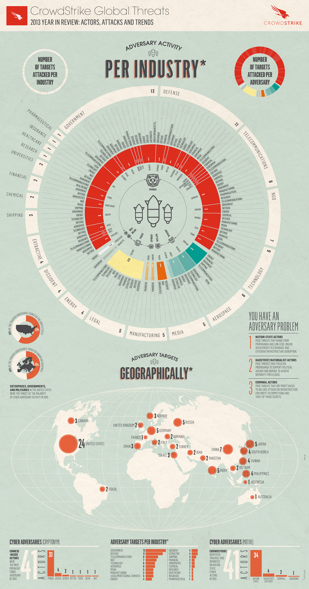

# P036-I02｜网络威胁环形关系与地图版式

## 原图与来源

- 案例编号：P036-I02；本库标题为检索描述，不自动视为原作正式名称。
- 来源：用户提供的《第三讲-信息图形类型学_PPT图片提取包.zip》，课件第 36 页、第 2 张图。
- 素材包原路径：`常用信息图形案例库/15-编年图与编目混合型信息图形Chronological-Cataloged Mixed/01-示例图/PPT第36页-图片02.png`。
- 原图：1250×2381 像素，保留提取文件的原始字节；SHA-256：`f155a935303779c9cbcc6aa5c44768fd1d39999644cc190719199b1c47dc3688`。
- 作者、原始发表日期、数据原始出处：未独立核对，原图可见标识不自动等于作者署名。
- 本记录更新：2026-11-20；已核对可见画面结构并完成 A—E 分析，细小数值与原始数据仍以核对状态为准。

## 可直接观察的画面

与同页另一幅共享主题，顶部改为同心环形节点与跨环连线，下方保留世界地图和统计组件。

## A 基本的数据逻辑

同一主题中按行业、行为者与地域组织关系，可能是同一项目的版式变体。

## B 统计图形与计算

环形关系图与地图组合；半径、弧长不自动表示时间。

## C 视觉编码

环带分区、彩线连接对象，圆形节点和颜色帮助识别群组。

未在画面中建立明确数值映射的大小、颜色、纹理与立体效果，不据此反算数据；没有出现的视觉要素不强行补写。

## D 数据／信息架构

由环形主图到地图和底部小图，形成总览与细节。

## E 视觉叙事架构

可与另一版对比：环形提升围合感，但读者需更多图例理解。

以上为根据编排作的阅读路径分析，不是经过眼动或记忆实验测得的结果。

## 边界、待核实项与方法修订

不将两个版式计为两组独立数据证据；年份标题也不足以建立编年逻辑。

本记录的画面描述属于直接观察；数据关系与叙事路径属于分析解释。原始统计表、作者意图和未辨清的微小标签不补造。新证据出现时同步修订此记录、类型方法和相关逻辑文档。

## 关联文档

[本类型说明与案例索引](README.md) · [全部常用类型](../README.md) · [来源与页码对照](../PDF对照与案例索引.md)

相关数据逻辑或判别边界：[编目型信息图形概念定义](../../01-信息图形数据逻辑/03-编目型信息图形概念定义.md) · [地理图形信息图形概念定义](../../01-信息图形数据逻辑/05-地理图形信息图形概念定义.md)。
