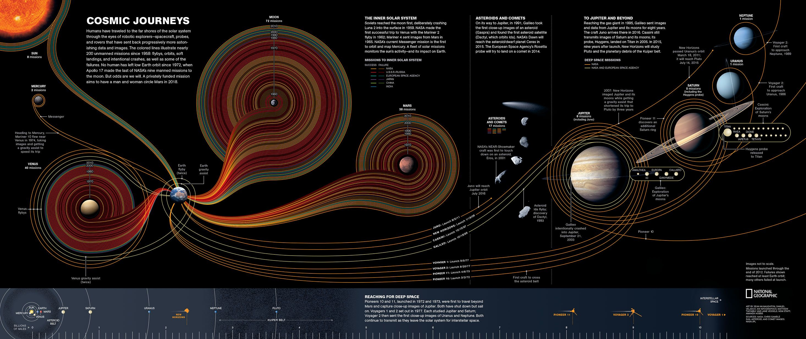

# P037-I01｜太阳系任务轨迹与年代复合图

## 原图与来源

- 案例编号：P037-I01；本库标题为检索描述，不自动视为原作正式名称。
- 来源：用户提供的《第三讲-信息图形类型学_PPT图片提取包.zip》，课件第 37 页、第 1 张图。
- 素材包原路径：`常用信息图形案例库/15-编年图与编目混合型信息图形Chronological-Cataloged Mixed/01-示例图/PPT第37页-图片01.png`。
- 原图：2931×1235 像素，保留提取文件的原始字节；SHA-256：`8ce579ac38ec9360224690202a65d216ea3bd394eb8da7028023d6d025f7b7bb`。
- 作者、原始发表日期、数据原始出处：未独立核对，原图可见标识不自动等于作者署名。
- 本记录更新：2026-11-20；已核对可见画面结构并完成 A—E 分析，细小数值与原始数据仍以核对状态为准。

## 可直接观察的画面

黑底上太阳、行星、彩色弯曲轨迹与任务注释占据主体，底部另有横向年代带。

## A 基本的数据逻辑

航天任务对象与发射／飞行时间、目标天体、路径共同组织。

## B 统计图形与计算

轨迹示意叠加时间带；轨迹弯曲程度与长度不直接等于实际飞行距离或时长。

## C 视觉编码

颜色区别任务路径，行星符号识别目标，底部位置组织年代。

未在画面中建立明确数值映射的大小、颜色、纹理与立体效果，不据此反算数据；没有出现的视觉要素不强行补写。

## D 数据／信息架构

上部空间关系总览，中部任务解释，底部年代索引互相连接。

## E 视觉叙事架构

先识别太阳系范围，再跟随任务轨迹，并在底部查时间顺序。

以上为根据编排作的阅读路径分析，不是经过眼动或记忆实验测得的结果。

## 边界、待核实项与方法修订

是空间、编年与编目交叉案例；实际轨道比例和任务清单须依原数据核对。

本记录的画面描述属于直接观察；数据关系与叙事路径属于分析解释。原始统计表、作者意图和未辨清的微小标签不补造。新证据出现时同步修订此记录、类型方法和相关逻辑文档。

## 关联文档

[本类型说明与案例索引](README.md) · [全部常用类型](../README.md) · [来源与页码对照](../PDF对照与案例索引.md)

相关数据逻辑或判别边界：[编年型信息图形概念定义](../../01-信息图形数据逻辑/01-编年型信息图形概念定义.md) · [编目型信息图形概念定义](../../01-信息图形数据逻辑/03-编目型信息图形概念定义.md) · [地理图形信息图形概念定义](../../01-信息图形数据逻辑/05-地理图形信息图形概念定义.md)。
