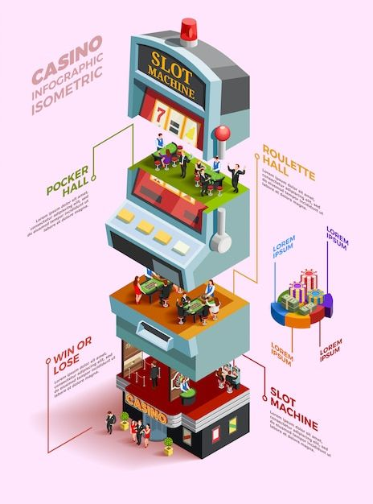

# P038-I02｜赌场主题等距立体分层示意

## 原图与来源

- 案例编号：P038-I02；本库标题为检索描述，不自动视为原作正式名称。
- 来源：用户提供的《第三讲-信息图形类型学_PPT图片提取包.zip》，课件第 38 页、第 2 张图。
- 素材包原路径：`常用信息图形案例库/16-三维信息图形3D Infographics/01-示例图/PPT第38页-图片02.jpg`。
- 原图：464×626 像素，保留提取文件的原始字节；SHA-256：`41e4ff3670b3819b2f93ebdee6e401e593b4b928ef455bec457721f2d63adf59`。
- 作者、原始发表日期、数据原始出处：未独立核对，原图可见标识不自动等于作者署名。
- 本记录更新：2026-11-20；已核对可见画面结构并完成 A—E 分析，细小数值与原始数据仍以核对状态为准。

## 可直接观察的画面

粉色背景上，老虎机外形被分为多个等距空间层，含人物、桌面与筹码，侧边有图解标签和 Lorem Ipsum 字样。

## A 基本的数据逻辑

主题空间及娱乐功能的概念分组。

## B 统计图形与计算

等距立体图与局部圆形组件；可见占位文字，未形成可核对统计数据集。

## C 视觉编码

立体层面组织空间，物件符号标功能，细线连接说明，粉色形成主题背景。

未在画面中建立明确数值映射的大小、颜色、纹理与立体效果，不据此反算数据；没有出现的视觉要素不强行补写。

## D 数据／信息架构

整体老虎机隐喻包围多个场景，旁边小图补充视觉组件。

## E 视觉叙事架构

先识别老虎机，再逐层探索不同场景。

以上为根据编排作的阅读路径分析，不是经过眼动或记忆实验测得的结果。

## 边界、待核实项与方法修订

作为三维表现方法参考；占位文本和装饰图表不构成真实统计证据。

本记录的画面描述属于直接观察；数据关系与叙事路径属于分析解释。原始统计表、作者意图和未辨清的微小标签不补造。新证据出现时同步修订此记录、类型方法和相关逻辑文档。

## 关联文档

[本类型说明与案例索引](README.md) · [全部常用类型](../README.md) · [来源与页码对照](../PDF对照与案例索引.md)

相关数据逻辑或判别边界：[层级型信息图形概念定义](../../01-信息图形数据逻辑/02-层级型信息图形概念定义.md) · [编目型信息图形概念定义](../../01-信息图形数据逻辑/03-编目型信息图形概念定义.md)。
