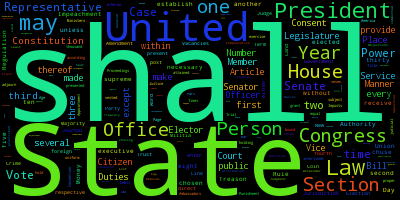

# W001｜美国宪法文本的矩形词频词云

## 基本信息与原图

- 本库编号与检索描述：W001；美国宪法文本的矩形词频词云。来源称谓：Constitution／Minimal Example，非本库补拟的原作正式标题。
- 来源：开源项目 amueller/word_cloud 的 [examples/constitution.png](https://github.com/amueller/word_cloud/blob/93c5e4cd50c5f2c56ec7eb624a620790dab5df6c/examples/constitution.png)；项目 README 将该图与 [simple.py](https://github.com/amueller/word_cloud/blob/93c5e4cd50c5f2c56ec7eb624a620790dab5df6c/examples/simple.py) 对应。
- 语料：项目 [constitution.txt](https://github.com/amueller/word_cloud/blob/93c5e4cd50c5f2c56ec7eb624a620790dab5df6c/examples/constitution.txt)。示例将其描述为美国宪法文本；本次未对照官方宪法版本逐条校勘，不补充修正案范围或全文完整性结论。
- 署名：项目许可为 Andreas Christian Mueller；图片的单独作者、首次生成日期、生成时依赖版本及随机种子未知。
- 来源快照：`93c5e4cd50c5f2c56ec7eb624a620790dab5df6c`；核对日期：2026-11-20。
- 原图文件：W001.png；400×200 px；58663 bytes；58663 bytes；保留来源文件字节。
- SHA-256：`0b0dce4d6f0601dcc1114e90492859e7e040ed85ec7aba111b6557b89c31ffed`。
- 原图 Git blob SHA：`595a9f3b8bdb2cff736646af138224eaca263908`。
- 来源为外部参考，不占用课件 P 编号或用户图 C 编号；无课件页码，非其他已归档图的变体。
- 状态：来源已登记／画面已核对／A—E已分析／源码机制已核对／原图精确词频与历史生成环境未复核／原则已同步。许可说明见[第三方许可](第三方许可.txt)。

## 可直接观察的画面

画面为黑底矩形，词项以不同字号和蓝、绿、黄等颜色填入可用空间。shall 和 State 特别突出，可见 United、President、Congress 等词；大小词交错，兼有横排和竖排。图内没有数值轴、词频标签、颜色图例或原文定位。

上述是图像观察，不是按像素反算的词频排名；没有从视觉上为任一词填写出现次数。

## A 基本的数据逻辑

按“01编目主逻辑 → 02词云主标签 → 11可视化文本交叉标签”归档。词项作为离散对象，清洗归并后获得权重，数值排序是辅助关系；位置不是地理坐标，字号大小不是父子包含关系，也没有按字母序提供检索。

可重建的分析表为 document_id、term、normalized_term、count、weight；这是本库分析用结构，并非声称原项目直接存有同名表。原始文本与聚合词表须分开保存。

## B 统计图形与计算

这是词云，表达文本统计结果的概览。关联脚本读取 constitution.txt 后调用 WordCloud().generate(text)。所读实现会进行词项提取、停用词过滤和词形处理，且默认允许搭配识别；不能把结果简单等同于未经清洗的空格切词次数。

权重经排序与归一化参与字号设置；字体、词长和空间适配还会影响最终占地。原图缺少量尺，历史生成参数未确认，因此既不写“字号正比词频”，也不把某词的可见面积解释为文本百分比。

精确复核应使用明确版本和同一语料重新输出统计表，并说明单词与短语口径；本次仅核对来源与机制，未声称重算得到历史 PNG 的数值。

## C 视觉编码

| 要素 | 观察与含义 |
| --- | --- |
| 文字 | 识别词项本身，兼作图形标记 |
| 字号 | 形成权重显著性，具体映射与排版调整不可由原图反推 |
| 色彩 | 原图多色但无类别图例；关联简单示例未指定词类配色，故不解释为情绪或主题类别 |
| 位置／方向 | 填充与避让形成布局；相邻不证明共现，竖排不代表某种数据类别 |
| 线／面／体 | 没有可辨认的数据连线或定量体积；黑色画布只作背景 |

## D 数据／信息架构

数据层为“语料 → 清洗与词项归并 → 词项统计 → 布局”；图像层只有概要词云，缺少方法与细节。用于正式信息图形时，应在外侧增加语料范围、清洗规则、权重口径、词表和原文链接。

图中文字构成集合，没有可见树状嵌套，也没有 A—Z 目录；语法用词特别突出是否符合读者问题，需要回到统计任务评估，不能仅以“大词醒目”视为分析完成。

## E 视觉叙事架构

大词提供首个入口，读者再自由扫描周边中小词。它提示反复出现的文本用语，但不能直接证明哪些制度最重要、读者最支持什么，或条款的法律效力差异。

改进可加一组同口径条形图，并允许从词项返回相关原句；这是设计建议，不是原图已有功能，也没有进行读图实验。

## 可复用制作方法

固定文本版本 → 明确清洗和搭配规则 → 导出词频表 → 设置权重与字号映射 → 保存字体、画布和随机种子 → 排版检查 → 补齐标题、口径和原文入口。若停用词策略调整，应同时报告对高频词的影响。

## 边界与待核实项

原图的精确词频、生成参数与历史依赖版本未知；不据当前默认值替代历史事实。源文本是否包含全部修正案未独立核对。词频不能代替内容重要性，彩色不能自动代替分类。

[本类索引](README.md) · [详细方法](类型说明.md) · [编目定义](../../01-信息图形数据逻辑/03-编目型信息图形概念定义.md) · [字母表边界](../../01-信息图形数据逻辑/04-字母表型信息图形概念定义.md) · [可视化文本](../11-可视化文本/README.md)
