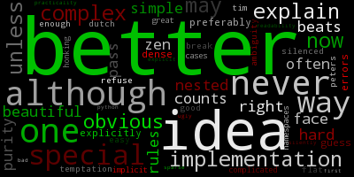

# W002｜Python 之禅文本的人工分组配色词云

## 基本信息与原图

- 本库编号与检索描述：W002；Python 之禅文本的人工分组配色词云。来源示例名称：Colored by Group Example。
- 来源图：[examples/colored_by_group.png](https://github.com/amueller/word_cloud/blob/93c5e4cd50c5f2c56ec7eb624a620790dab5df6c/examples/colored_by_group.png)；关联源码：[colored_by_group.py](https://github.com/amueller/word_cloud/blob/93c5e4cd50c5f2c56ec7eb624a620790dab5df6c/examples/colored_by_group.py)。
- 语料：关联示例脚本内置的 The Zen of Python，并注明 Tim Peters；这不是用户意见调查或公众态度样本。
- 署名：项目许可为 Andreas Christian Mueller；图片的单独制作者、首次生成日期、历史依赖版本和随机种子未知。文本作者与图片作者分开记录。
- 来源快照：`93c5e4cd50c5f2c56ec7eb624a620790dab5df6c`；核对日期：2026-11-20。
- 原图文件：W002.png；400×200 px；40865 bytes；40865 bytes；保留来源文件字节。
- SHA-256：`97146e40afa4b814fae2ec716cd097ab9b7965658a423338a430ce4f79c7be60`。
- 原图 Git blob SHA：`9b56b286fc8f0a3a139e6f4ced95d8a76d4d7af5`。
- W 为外部词云参考序列，不是课件页码或用户原图序列；与 W001 是同一工具的不同语料和方法示例，不当作两个独立研究实验。
- 状态：来源已登记／画面已核对／A—E已分析／源码机制已核对／历史图像精确计数及生成环境未复核／原则已同步。许可说明见[第三方许可](第三方许可.txt)。

## 可直接观察的画面

画面为黑底矩形，最大词 better 为绿色，另有明显的浅灰大词 idea；绿色、红色和灰色文字混排，可见红色 complex、special，以及多种字号的其他词。大小词沿空隙填充，兼有水平和垂直方向。图中没有颜色图例、类别标题、数值标注或坐标轴。

红绿灰的分类机制来自源码核对，不能只凭画面颜色判断其规则。

## A 基本的数据逻辑

按“01编目主逻辑 → 02词云主标签 → 11可视化文本交叉标签”归档。先归并同一词项，再叠加源码给出的人工颜色词表；词频是数值属性，颜色类别是另一属性。

建议结构为 term_id、normalized_term、count、color_group、assignment_rule、source。人工词类与语料来源分开保存；颜色类别不构成父子树，邻接位置也不构成词语网络。

## B 统计图形与计算

源码先将文本转为小写，以 collocations=False 关闭双词搭配识别，再生成词云；它仍会使用工具其他适用的清洗与词形规则，不能简单称作“只做小写的原始词频”。

随后按照人工 color_to_words 表改色，未列入的词使用灰色系。改色作用于已生成的布局，不重新计算词项频率或情感分数；同一词的字号与颜色承担不同信息。源码还允许在某一指定色相内变化明暗，这些明暗不额外编码强度。

历史 PNG 的精确频数、版本和种子未复算，因此不填具体次数，不把绿色面积与红色面积相除后称为“正负意见比例”。

## C 视觉编码

| 要素 | 编码与边界 |
| --- | --- |
| 词形 | 标识具体词项；源文已转为小写 |
| 字号 | 强调统计权重，受实际排版约束；无精确量尺 |
| 绿色／红色 | 对应脚本预定义的两份词项列表；其解释属于人工选词框架 |
| 灰色 | 表示不在两份颜色列表中的默认词项，不能自动称为中性情绪 |
| 同色明暗 | 配色函数的视觉变化，未绑定独立数值 |
| 位置／方向 | 用于布局填充和阅读，不表示语义距离或时间顺序 |
| 连线／体积 | 原图没有关系边或定量体积编码 |

原图红绿编码还缺少图内图例。正式发布时应添加类别文字说明，并检查色觉可辨性；不能只靠颜色传递分类。

## D 数据／信息架构

“固定文本 → 清洗和计数 → 基础词云布局 → 人工分类词表 → 改色输出”是两层编码结构。保留颜色表及作者的分类理由，才能使读者区分统计结果与人工解释。

本图没有原文上下文和颜色表入口。本库通过源码链接补充追溯；后续重制时，建议在图外列出颜色规则和高频词表，允许查回原句。文档数、词项数和某词出现次数不要混作同一种样本量。

## E 视觉叙事架构

绿色大词先形成入口，红色词产生对照，灰色词补足其他用语。颜色带来评价方向的联想，但真正的逻辑和限定条件仍在原句中；截取单词不能保留完整命题。

这种版式适合呈现“词频＋作者分组”两条线索，不足以支持自动情感识别结论。若要评价某一观点，应回到完整文本，而不是统计红绿字形的视觉面积。

## 可复用制作方法

明确语料与清洗规则 → 输出小写规范词表并关闭或记录搭配设置 → 校验频数 → 生成基础布局 → 通过可审计的词类表设置颜色 → 增加图例 → 与原文逐项核对解释。保存图形参数和工具版本；原图未固定种子时，不承诺重跑后位置完全一致。

## 边界与待核实项

颜色来自人工列表，不是词频阈值、机器情感概率或赞成／反对人数。该列表可能在具体语境下产生争议，应标明作者规则。未独立复现历史 PNG，不根据源码补填未知计数或生成时间；未进行阅读效果实验。

[本类索引](README.md) · [详细方法](类型说明.md) · [编目定义](../../01-信息图形数据逻辑/03-编目型信息图形概念定义.md) · [字母表边界](../../01-信息图形数据逻辑/04-字母表型信息图形概念定义.md) · [可视化文本](../11-可视化文本/README.md)
