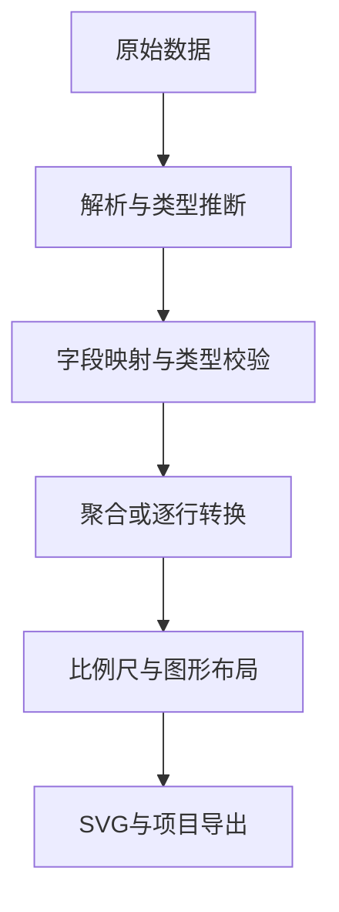

# RAWGraphs 架构与数据流程

## 1. 三层职责

| 层 | 源码定位 | 作用 |
| --- | --- | --- |
| 应用 | [src/App.js](https://github.com/rawgraphs/rawgraphs-app/blob/48c3b2ee9ff412721a2c99c7bed38e734b3fa534/src/App.js)、[src/charts.js](https://github.com/rawgraphs/rawgraphs-app/blob/48c3b2ee9ff412721a2c99c7bed38e734b3fa534/src/charts.js) | React 状态管理；加载数据、选图、字段映射、定制预览、导出五阶段；内置 chart 与自定义图表合并 |
| 数据接入 | [src/hooks/useDataLoaderUtils/parser.js](https://github.com/rawgraphs/rawgraphs-app/blob/48c3b2ee9ff412721a2c99c7bed38e734b3fa534/src/hooks/useDataLoaderUtils/parser.js)、[src/hooks/useDataLoaderUtils/stack.js](https://github.com/rawgraphs/rawgraphs-app/blob/48c3b2ee9ff412721a2c99c7bed38e734b3fa534/src/hooks/useDataLoaderUtils/stack.js) | JSON/CSV/SPARQL 识别；d3-dsv 分隔解析；宽表转长表 |
| 核心 | [src/dataset.js](https://github.com/rawgraphs/rawgraphs-core/blob/8f03257fa7abe7d6f87e6e9d0a818612fb421eae/src/dataset.js)、[src/rawGraphs.js](https://github.com/rawgraphs/rawgraphs-core/blob/8f03257fa7abe7d6f87e6e9d0a818612fb421eae/src/rawGraphs.js)、[src/mapping.js](https://github.com/rawgraphs/rawgraphs-core/blob/8f03257fa7abe7d6f87e6e9d0a818612fb421eae/src/mapping.js) | 类型推断、解析错误、校验映射、执行声明式或函数式映射，建立 chart 实例 |
| 聚合 | [src/expressionRegister.js](https://github.com/rawgraphs/rawgraphs-core/blob/8f03257fa7abe7d6f87e6e9d0a818612fb421eae/src/expressionRegister.js) | 按字段配置取聚合函数或默认聚合 |
| 图形实现 | [charts/src](https://github.com/rawgraphs/rawgraphs-charts/tree/cade3b6e1b4d35d365440b1365d51b0dd48c9bce/src) | 各图独立声明维度、映射、布局绘制及视觉参数 |
| 预览与导出 | [src/worker/worker.js](https://github.com/rawgraphs/rawgraphs-app/blob/48c3b2ee9ff412721a2c99c7bed38e734b3fa534/src/worker/worker.js)、[src/components/ChartPreview/ChartPreview.js](https://github.com/rawgraphs/rawgraphs-app/blob/48c3b2ee9ff412721a2c99c7bed38e734b3fa534/src/components/ChartPreview/ChartPreview.js)、[src/components/Exporter/Exporter.js](https://github.com/rawgraphs/rawgraphs-app/blob/48c3b2ee9ff412721a2c99c7bed38e734b3fa534/src/components/Exporter/Exporter.js) | Comlink worker 执行解析与映射，主界面呈现 DOM；SVG 序列化、canvas 栅格化 PNG/JPG、项目 JSON |

## 2. 数据管道

CSV 分隔符候选以首行字段数评价，须人工核对小数/千分位、日期及引号。JSON 归一化将数组中的标量连接成文本、一层对象展开为点号字段，不能视为完整保留任意层级关系。stackData(data,column) 将每行保留键列，其余列展开为 column（原列名）、value（原值）；注意不要把备注、单位等误当度量列。核心 parseDataset 输出 dataset、dataTypes、errors；字段推断不能替代语义判断（如数字编码、邮编、年份）。

实例的 chartImplementation 有 metadata、dimensions、mapData、render、visualOptions 等接口。dimensions 描述 required、multiple、minValues、validTypes、aggregation 及默认聚合；mapping 保存原列名和 config.aggregation。core 校验后可执行函数形式 mapData，或由 makeMapper 将 get、group、rollup 等声明式操作转换为映射；render 得到映射结果、视觉选项及原始数据。图表并非全部使用同一种聚合过程。

## 3. 数据关系与变换清单

| 数据结构 | 典型数据键 | 图表机制 |
| --- | --- | --- |
| 长表 | 类别、时间、值 | group/rollup、折线、条形、流图 |
| 宽表 | 对象、指标A、指标B | 多列聚合/展开、分组条形、平行坐标、雷达 |
| 样本表 | 样本ID、连续值或X/Y | 逐行、分位数、分箱、密度或点布局 |
| 层级路径 | 一级、二级、叶对象、权重 | 多层分组、叶权求和、树布局 |
| 边表 | source、target、weight | 对边聚合、网络或流带布局 |
| 阶段宽表 | 阶段1…N、weight | 相邻阶段转移汇总 |

注册的聚合：count（行数）、countDistinct（去重数）、mean、max、min、sum、median、csv、csvDistinct。count 不等于非空数，求和不等于平均；比例需提供分子分母以便重算。某些图无 Size 时按记录数，有些按每组1，逐图核对。
例：A类三条记录值2、3、7，sum=12、count=3、mean=4、median=3；同样外观条形可以对应完全不同的统计口径。

## 4. 编码与布局

线性比例尺把量映射到位置或长度；时间尺度则依据日期间隔；band/point 将类别离散定位，不能把顺序当大小。若半径 r∝sqrt(v)，且量尺从零起点，则圆面积 πr²∝v；若最小半径非零或存在截断就不能断言严格比例。层级包含、流带路径、节点位置、避让等几何布局有部分只承担阅读组织，不必都映射数据。颜色区分名义分类或量值须由映射及图例证实。

## 5. 实现与设计分离

导出项目保存原始输入、解析参数、图形选择、映射、visualOptions 等；SVG可用于进一步排版，但改动数据相关长度、面积、颜色与刻度必须同步校验。PNG/JPG 不保留可编辑向量信息。不要从SVG路径形态倒推出未见的原始统计表。

[返回03索引](README.md)
