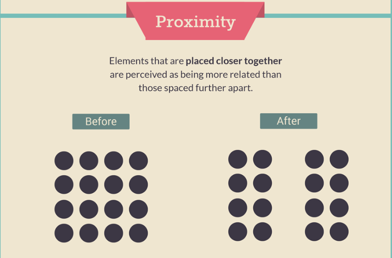
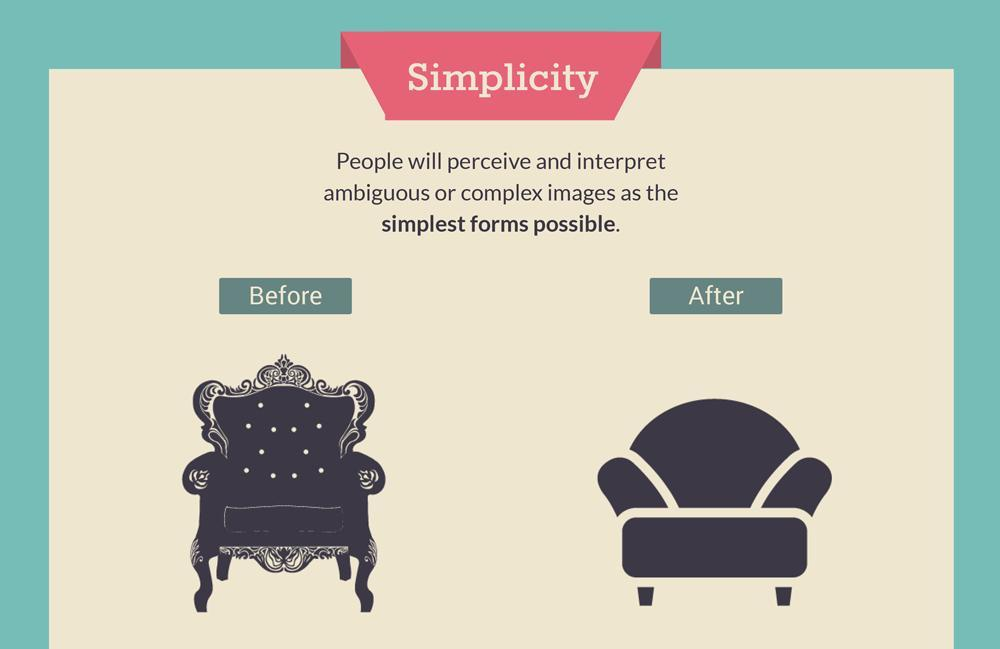
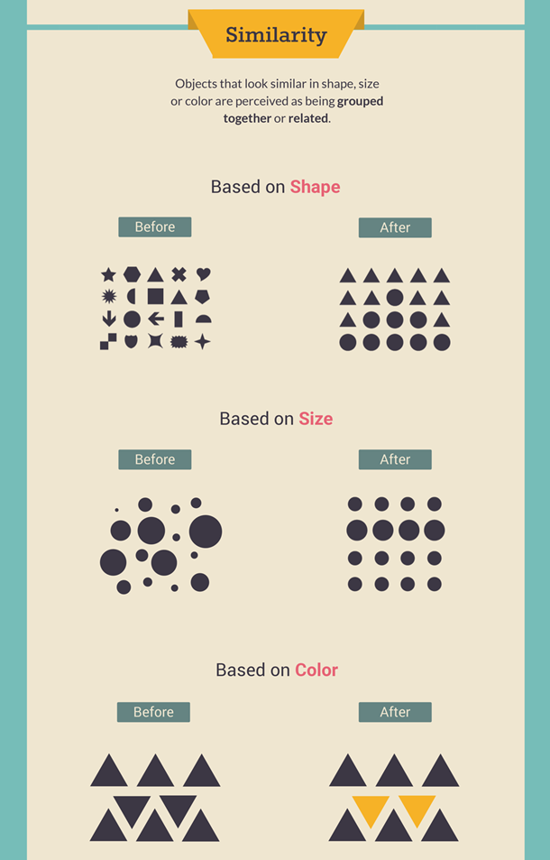
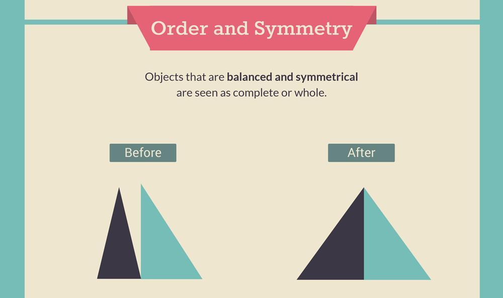
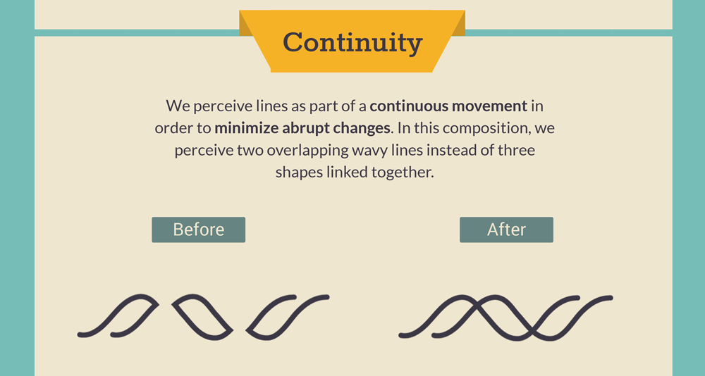
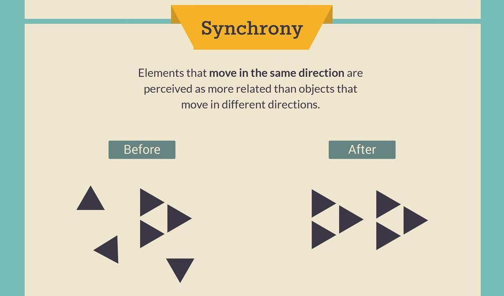
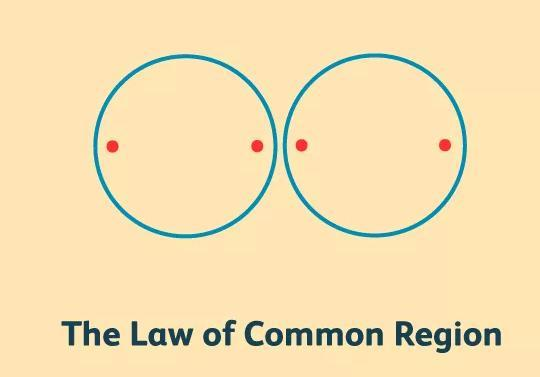
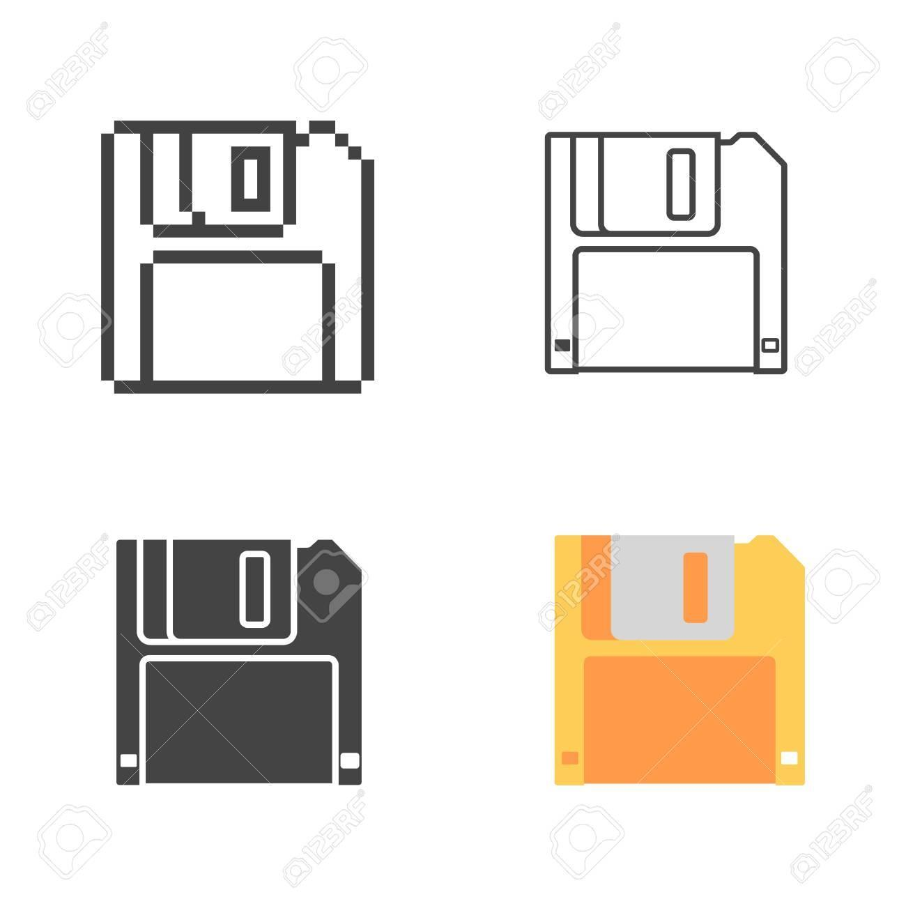

# PDF视觉组织原理与配图

来源：用户提供的《交互信息设计_编辑版(1).pdf》，共66页；以下页码为PDF物理页码。

本页围绕“元素依靠什么线索被组织成一组、路径或整体”展开，记录简短的原理分析。

图片直接取自 PDF 内嵌配图。下文结合可见细节说明各图的组织线索。

## 导入图｜模式识别（PDF 第33页）

中央方块、四角方框和四边的圆相互呼应。黑色斜线把它们连在一起，读者可以先辨认整个对称图案，再逐一查看构件。

## 1. 邻近／接近原则（Proximity）

距离较近的元素容易被组织为一组。信息图形中，可通过组内紧凑、组间留白，让读者辨认哪些文字、符号和数据属于同一单元。

两边各有十六个同色圆点。右图只把中间的列距拉大，原来的四列就容易读成左右两组，每组八点。排版时，同样的留白可以把一条标签和它对应的数值留在一起。

来源：PDF第34页。延伸阅读：[邻近／接近原则](01-接近原则-Proximity.md)。

## 2. 简单原则（Simplicity）

视觉组织倾向于形成较规则、连贯的整体。设计时应让结构关系清楚，减少相互冲突的线索；简单不等于删除必要信息。

左椅的花纹、铆钉和椅背装饰在右图中被省去，弧形靠背、外张的扶手和宽坐垫仍交代了椅子的结构。画设施图标时，优先保留这些帮助识别物体的轮廓。

来源：PDF第35页。延伸阅读：[简单原则](12-简洁与良好形态原则-Pragnanz.md)。

## 3. 相似原则（Similarity）

属性相似的元素容易被归为同类。重复使用颜色、形状或大小，可以让分散的元素建立类别关联；同一种视觉属性应保持相同含义。

三排对照依次突出形状、大小和颜色。最下排右图把两个倒三角涂成黄色，即使它们与正三角形交错排列，也能一眼配成一组。

来源：PDF第36页。延伸阅读：[相似原则](02-相似原则-Similarity.md)。

## 4. 闭合原则（Closure）

分散或不完整的轮廓可能被组织成完整形状。设计可适度省略辅助轮廓，让整体仍能被识别；缺失的统计数据不能据此补造。

右图用两道底色间隙切断球身，三块深色区域的外缘仍沿着同一条椭圆形轮廓延伸。中间的缝线进一步提示物体身份，因此读者可以补全橄榄球。

来源：PDF第37页。延伸阅读：[闭合原则](04-闭合原则-Closure.md)。

## 5. 对称原则（Symmetry）

镜像对应的部分容易形成统一结构。对称关系可以帮助读者识别整体和比较对应项，但不意味着左右的数据相等。

左图的深浅两个三角形各有一个顶点。右图中，两块沿同一条竖边拼合，共享一个顶点，中线两侧的外轮廓互为镜像。读者因此容易先看到一个大三角形，再看到它包含的两部分。

来源：PDF第38页。延伸阅读：[对称原则](09-对称原则-Symmetry.md)。

## 6. 连续性原则（Continuity）

走向连贯的元素容易被组织成同一路径。流程、线路和阅读顺序应保持清楚的延续关系，避免交叉位置使读者误入另一条路径。

左图的曲线分成几个局部形状。右图中线条交叉后仍沿原来的弧度延伸，沿切线方向追踪，就能读出两条波线。线路图也可用同样的走向帮助读者穿过交叉点。

来源：PDF第39页。延伸阅读：[连续性原则](03-良好连续原则-Good-Continuation.md)。

## 7. 同步原则（Synchrony）

同时发生状态变化的元素容易被组织为相关的一组。动态图形中，可通过同步反馈表达对应关系；静态图片只能说明这一机制，不能展示完整时间过程。

左图的小三角形朝向各异，右图的小三角形全部朝右，并排成两簇。课件题为“同步”，图中文字用同向运动解释关联。静态图能展示朝向，判断时间上的同步还需要看到元素何时开始或改变运动。

来源：PDF第40页。延伸阅读：[同步原则](08-同步原则-Synchrony.md)。

## 8. 同域原则（Common Region）

同处一个有边界区域内的元素容易被看作一组。外框或底色区域可以表示共同归属。课件英文将 Common Fate／Region 并写；此处按“同域”解释为共同区域，协调运动另见共同命运原则。

靠近中央的两个红点距离很近，却分别落在两个蓝圈里。沿边框看，每个红点都与本圈内较远的红点配成一组。这里可以直接观察到边界如何与距离提供不同的分组线索。

来源：PDF第41页。延伸阅读：[同域原则](05-共同区域原则-Common-Region.md)。

## 9. 同构原则（异质同构）（Isomorphism）

保留课件的“同构”条目，关注不同表达之间能够对应的结构关系。应用时应明确哪些部分、次序或关系保持对应，不能只凭外形相似就断定表达了同一关系。

四个软盘图标采用像素、细线、深色块和橙黄色块。外壳的折角、上方滑盖与下方标签区在不同画法中仍占据对应位置，因此可以通过部件关系识别同一物体。

来源：PDF第42页。课件补充条目；其术语范围与普通分组原则有所区别。

